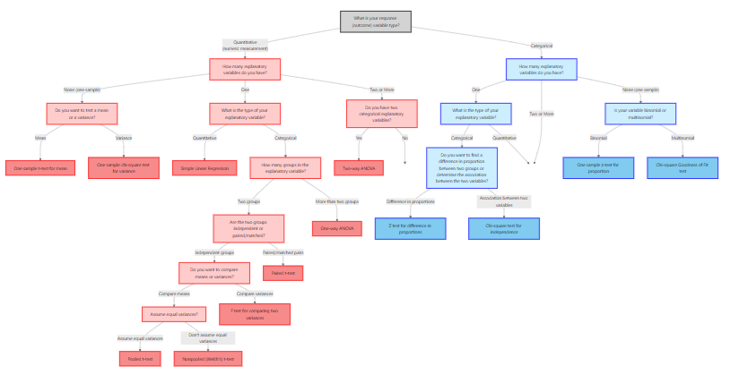
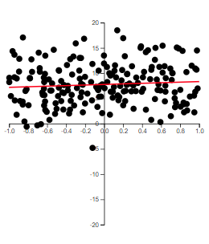
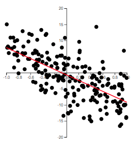
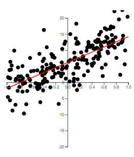
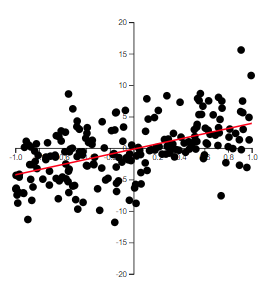
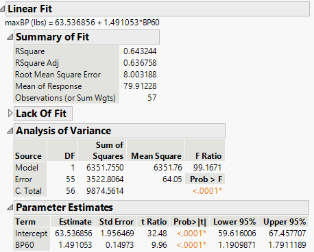
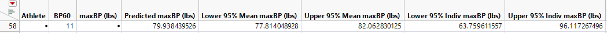
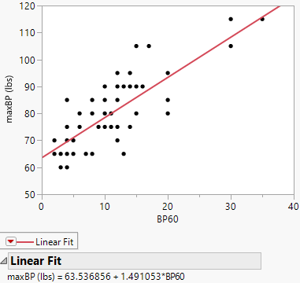
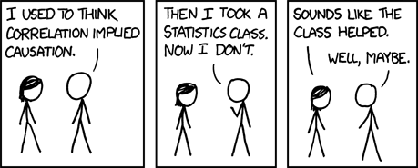

# Correlation and Simple Linear Regression

## Scatterplots and the Correlation Coefficient {#sec-14_01}

> "The modern student, and too often his teacher, overlook the fact that such a simple thing as a scatter diagram is a more important tool of prediction than the correlation coefficient..." – W. Edwards Deming




When exploring two numerical variables, the first step is to look at the variables graphically.  A **scatterplot** is simply a collection of points in the plane where each point represents one observation.  We usually plot the explanatory variable on the horizontal axis and the response variable on the vertical axis.  If you are unsure which variable should go on which axis, it often does not matter for descriptive purposes, but if your goal is prediction you should place the variable you wish to predict on the vertical axis.

Scatterplots reveal patterns that numbers alone cannot.  If the points lie cluster around a straight line, the relationship is approximately **linear**.  If the points form a curved band, the association is nonlinear.  The closer the points are to a straight line, the stronger the linear relationship.  Outliers can distort our impression, so always scan the plot before jumping into calculations.

### Measuring linear association

To quantify the strength and direction of a linear relationship we use the **correlation coefficient**.  

It is computed as
$$
\begin{align*}
    {r=\frac{SS_{xy}}{\sqrt{SS_{xx}SS_{yy}}}}
\end{align*}
$$
where
$$
\begin{align*}
SS_{xy} =& \sum \left(y_i-\bar{y}\right)\left(x_i-\bar{x}\right)\\
SS_{xx} =& \sum \left(x_i-\bar{x}\right)^2\\
SS_{yy} =& \sum \left(y_i-\bar{y}\right)^2
\end{align*}
$$


$SS_{xx}$ and $SS_{yy}$ are measures of *variability* of $x$ and $y$, respectively. That is, they indicate how $x$ and $y$ varies about their mean, individually.


$SS_{xy}$ is a measure of how $x$ and $y$ vary *together*.


For example, consider the data in the scatterplot below. The two red lines represent the mean of the $x$ variable (the vertical red line is for $\bar{x}$) and the mean of the $y$ variable (the horizontal red line is for $\bar{y}$).

```{r message=FALSE, warning=F, echo=FALSE}
library(tidyverse)

x = c(1, 2 ,2.75, 4, 6, 7, 8, 10)
y = c(2, 1.4, 1.6, 1.25, 1, 0.5, 0.5, 0.4)

dat =  tibble(x, y)

ybar =  mean(y)
xbar =  mean(x)

ggplot(data=dat, aes(x = x, y = y)) +
  geom_point() +
  xlim(0,10) +
  ylim(0,2) +
  geom_hline(yintercept = ybar,col="red") +
  geom_vline(xintercept = xbar, col="red")

```


Let's find $SS_{xx}$, $SS_{yy}$, and $SS_{xy}$.

```{r message=FALSE, warning=F, echo=FALSE}
`(x-xbar)` = x-xbar
`(y-ybar)` = y-ybar

`(x-xbar)(y-ybar)` = `(x-xbar)`*`(y-ybar)`

dx = x - xbar
dy = y - ybar
dxdy = dx*dy


dat1 = tibble(
  `$x$` = x,
  `$y$` = y,
  # `$x - \\bar{x}$` = dx,
  # `$y - \\bar{y}$` = dy,

  `$(x - \\bar{x})^2$` = dx^2,
  `$(y - \\bar{y})^2$` = dy^2,
    `$(x - \\bar{x})(y - \\bar{y})$` = dx * dy
)

knitr::kable(
  dat1
)

```

Note that each value in $(x_i-\bar{x})(y_i-\bar{y})$ is negative. This is because as $x$ is below $\bar{x}$, $y$ is above $\bar{y}$. Likewise, as $x$ is above $\bar{x}$, $y$ is below $\bar{y}$. In the scatterplot above, you can see how the observations are below or above these lines.


Summing up the values give us:
$$
\begin{align*}
SS_{xx} =& \sum \left(x_i-\bar{x}\right)^2\\
 = & `r sum(dx^2 )`\\\\
SS_{yy} =& \sum \left(y_i-\bar{y}\right)^2\\
= & `r sum(dy^2)`\\\\
SS_{xy} =& \sum \left(y_i-\bar{y}\right)\left(x_i-\bar{x}\right)\\
 = & `r sum(dxdy)`
 \end{align*}
$$


::: {.example collapse="false" title="Example 14.1: Volume of Lumber"}


In the following scatterplot, the volume of timber from 31 black cherry trees are plotted against the diamter of the tree measured at 54 inches off the ground. 


Again, we plot the data with red lines representing $\bar{x}$ and $\bar{y}$.


```{r message=FALSE, warning=F, echo=FALSE}
library(datasets)
x = trees$Girth
y = trees$Volume
xbar = mean(trees$Girth)
ybar = mean(trees$Volume)

ggplot(data=trees, aes(x=Girth, y=Volume)) +
  geom_point() +
  geom_hline(yintercept = ybar,col="red") +
  geom_vline(xintercept = xbar, col="red")+
  xlab("diameter")


```


```{r message=FALSE, warning=F, echo=FALSE}
library(datasets)
library(tidyverse)
dx = x - xbar
dy = y - ybar
dxdy = dx*dy


dat1 = tibble(
  `$x$` = x,
  `$y$` = y,
  # `$x - \\bar{x}$` = dx,
  # `$y - \\bar{y}$` = dy,

  `$(x - \\bar{x})^2$` = dx^2,
  `$(y - \\bar{y})^2$` = dy^2,
    `$(x - \\bar{x})(y - \\bar{y})$` = dx * dy
)

knitr::kable(
  dat1
)
```


In this example, most of the observations have $(x-\bar{x})(y-\bar{y})$ that are positive. This is because these observations have values of $x$ that are below $\bar{x}$ and values of $y$ that are below $\bar{y}$, or values of $x$ that are above $\bar{x}$ and values of $y$ that are above $\bar{y}$.

There are four observations that have a negative value of $(x-\bar{x})(y-\bar{y})$.  Although they are negative, the value of $SS_{xy}$ is positive due to all the observations with positive values of $(x-\bar{x})(y-\bar{y})$. Therefore, we say if  $SS_{xy}$ is **positive**, then $y$ tends to increase as $x$ increases. Likewise, if $SS_{xy}$ is **negative**, then $y$ tends to decrease as $x$ increases.

If $SS_{xy}$ is zero (or close to zero), then we say  $y$ does not tend to change as $x$ increases.

:::


### Correlation Coefficient

We first note that $SS_{xy}$ cannot be greater in absolute value than the quantity
$$
\sqrt{SS_{xx}SS_{yy}}
$$
We will not prove this here, but it is a direct application of the Cauchy-Schwarz inequality .


Thus, the correlation coefficient
$$
\begin{align}
    r=\frac{SS_{xy}}{\sqrt{SS_{xx}SS_{yy}}}
\end{align}
$$
is a value sucha that
$$
-1\le r \le 1
$$

If $r=0$, then there is no linear relationship between $x$ and $y$.

If $r$ is positive, then the slope of the linear relationship is positive. If $r$ is negative, then the slope of the linear relationship is negative.


The closer $r$ is to one in absolute value, the stronger the linear relationship is between $x$ and $y$.


Because it is based on means and standard deviations, Pearson’s $r$ is sensitive to outliers and assumes the data are reasonably normal.  When one or both variables are non‑normal, a rank‑based measure such as Spearman’s rho may be used instead (not discussed in this course).

It is tempting to interpret a large correlation as evidence of **causation**, but correlation merely quantifies association.  Even a strong correlation can arise from confounding variables or chance.  Always consider the context and remember that a scatterplot and subject‑matter knowledge are essential for interpretation.

::: {.example collapse="false" title="Example 14.2: Age and Systolic Blood Pressure"}

To see how scatterplots and correlation work in practice, consider a small study of 20 adults ranging in age from 30 to 80 years.  The response variable is systolic blood pressure (measured in mm Hg).  The scatterplot below shows the relationship.

```{r}
#| echo: false
#| message: false


library(tidyverse)
set.seed(123)
df_med <- tibble(
  age      = seq(30, 80, length.out = 20),
  systolic = 90 + 0.8 * age + rnorm(20, 0, 5)
)
ggplot(df_med, aes(x = age, y = systolic)) +
  geom_point(color = "#2c7fb8") +
  geom_smooth(method = "lm", se = FALSE, color = "red") +
  labs(x = "Age (years)", y = "Systolic blood pressure (mm Hg)",
       title = "Scatterplot with fitted line: age vs systolic blood pressure") +
  theme_minimal()
```

The cloud of points slopes upward, indicating a positive relationship: older participants tend to have higher systolic blood pressure.  The correlation coefficient for this dataset is about 0.93, suggesting a strong positive linear association.

:::


### Some Examples of $r$

The best way to grasp correlation is to see examples. In @fig-05_01, scatterplots of 200 observations are shown with a least squares line.


::: {#fig-05_01 layout-ncol=2}

{#fig-05_01a}

{#fig-05_01b}

{#fig-05_01c}

{#fig-05_01d}

Examples of correlation
:::

Note how the value of $r$ relates to how spread out the points are from the line as well as to the slope of the line.


### The Population Correlation Coefficient


The correlation $r$ is for the observed data which is usually from a sample. Thus, $r$ is the  *sample* correlation coefficient.


We could make a hypothesis about the correlation of the *population* based on the sample. We will denote the population correlation with $\rho$. The hypothesis we will want to test is
$$
\begin{align*}
  H_0:\rho = 0\\
H_a:\rho \ne 0
\end{align*}
$$


The test statistic is
$$
\begin{align}
t & =\frac{r\sqrt{\left(n-2\right)}}{\sqrt{1-r^{2}}}
\end{align}
$$

If $H_0$ is true, then $t$ will have a Student's $t$-distribution with $n-2$ degrees of freedom.


### Creating scatterplots and computing correlation in JMP 

JMP makes it easy to explore the relationship between two quantitative variables:

- **Create a scatterplot.**  Load your data into a JMP table.  Choose **Graph → Graph Builder**, drag the explanatory variable to the X‑axis and the response variable to the Y‑axis, and select the *Scatter Plot* element.  You can add a fitted line by clicking the blue triangle next to **Fit Line**.
- **Compute the correlation.**  Choose **Analyze → Multivariate Methods → Multivariate**.  Select your variables and click **Y, Columns**.  JMP displays a matrix of scatterplots and gives the Pearson correlation coefficient in the correlation table.  If normality is questionable, use **Analyze → Multivariate → Nonparametric Correlations** for Spearman’s rho.

### Recap

| **Keyword/Concept** | **Explanation** |
|---|---|
| **scatterplot** | A graph of paired quantitative data where each point represents one observation; used to visualize the relationship between two variables. |
| **Pearson’s correlation coefficient (r)** | A measure of the strength and direction of a linear relationship, ranging from −1 to +1; positive values indicate direct association and negative values indicate inverse association. |


### Check your understanding

::: {.callout-note collapse="false" title="Problems"}

1. A study of 30 students reports a correlation of $r=0.85$ between hours studied and exam score.  What does this value tell you about the relationship?  Would you conclude that studying more *causes* higher scores?  Explain.
2. Sketch (or describe) how a scatterplot would look if $r\approx -0.6$.  What does the sign and magnitude of this correlation tell you about the relationship?

:::

::: {.callout-tip collapse="true" title="Solutions"}

1. The correlation of 0.85 indicates a strong positive linear association: students who study more tend to score higher.  However, correlation on its own does not prove causation.  Other factors (prior knowledge, test difficulty) may influence scores, and experimental control would be needed to establish a causal link.
2. A correlation of $-0.6$ produces a downward‑sloping cloud of points: as one variable increases, the other tends to decrease.  The moderate magnitude (0.6) suggests a reasonably strong inverse relationship but with noticeable scatter around a straight line.

:::

## Least Squares Regression Line {#sec-14_02}

> "Regression. It is a universal rule that the unknown kinsman in any degree of any specified man, is probably more mediocre than he."  – Francis Galton

After visualizing and quantifying the relationship between two variables, the next step is to model that relationship.  In **simple linear regression**, we seek the line that best predicts the response variable $y$ from the explanatory variable $x$.  The model has the form
$$
\begin{align*}
y = \beta_0 + \beta_1 x+\varepsilon
\end{align*}
$$
where:

- $y$ is the response variable (also known as the **dependent** variable)
- $x$ is the predictor variable (also called the **independent** variable or explanatory variable)
- $\varepsilon$  is the *random error* component
- $\beta_0$ is the *y-intercept* of the line (the point where the line intersects the y-axis)
- $\beta_1$ is the *slope* of the line (the change in the mean of $y$ for every 1-unit increase in $x$)

We use Greek symbols $\beta_0$ and $\beta_1$ to denote the y-intercept and slope of the line. These are population *parameters* with values that would only be known if we had access to the entire population of $(x, y)$ measurements.


::: {.callout-note}
## Review: Greek Letters in Notation
Usually, in Statistics, lower-case Greek letters are used to denote population parameters. In our model above, we have an exception. The Greek letter $\varepsilon$ is not a parameter, but a random variable (parameters are not random variables in frequentist statistics). 
:::


### Fitting the Model: The Method of Least Squares


Suppose we have the data shown in @tbl-table2_1 below and plotted in the scatterplot in @fig-2_1.


| x    | y    |
|------|------|
| 1    | 2    |
| 2    | 1.4  |
| 2.75 | 1.6  |
| 4    | 1.25 |
| 6    | 1    |
| 7    | 0.5  |
| 8    | 0.5  |
| 10   | 0.4  |

: Data for Scatterplot  {#tbl-table2_1}


```{r}
#| warning: false
#| echo: false
#| label: fig-2_1
#| fig-cap: Scatterplot of the data in @tbl-table2_1
library(tidyverse)
x = c(1, 2, 2.75, 4, 6, 7, 8, 10)
y = c(2, 1.4, 1.6, 1.25, 1, 0.5, 0.5, 0.4)
dat = tibble(x, y)

dat |> 
  ggplot(aes(x = x, y = y)) + 
  geom_point()

```


We hypothesize that a straight-line model relates *y* to *x*, as follows:

$$
y = \beta_0 + \beta_1 x + \varepsilon
$$


How can we use the data from the eight observations in @tbl-table2_1 to estimate the unknown y-intercept ($\beta_0$) and slope ($\beta_1$)?


We can start by trying some lines and see how well they fit the data. But how do we measure how well a line *fits* the data?

A quantitative method to evaluate how well a straight line fits a set of data is by measuring the deviations of the data points from the line.

::: {.callout-note}
## Review: Deviations of Response Variable
$y$ is the variable of interest, so we are focused on the differences between observed $y$ and the predicted value of $y$
:::

We calculate the magnitude of the *deviations* (the differences between observed and predicted values of $y$).

These deviations, or prediction errors, represent the *vertical* distances between observed and predicted values of $y$.

Suppose we try to fit the line
$$
    \hat{y} =2-.2x
$${#eq-02_01}

This line can be seen in @fig-2_2. 
```{r}
#| warning: false
#| echo: false
#| label: fig-2_2
#| fig-cap: Scatterplot of data in @tbl-table2_1 with the red line representing the line in @eq-02_01 
dat |> 
  ggplot(aes(x = x, y = y)) + 
  geom_point() +
  geom_abline(intercept = 2, slope = -0.2, color = "red")

```


The observed and predicted values of $y$, their differences, and their squared differences are shown in the table below.

| $x$  | $y$  | $\hat{y}$ | $(y - \hat{y})$ | $(y - \hat{y})^2$ |
|------|------|-----------|-----------------|------------------|
| 1    | 2    | 1.8       | 0.2             | 0.004            |
| 2    | 1.4  | 1.6       | -0.2            | 0.004            |
| 2.75 | 1.6  | 1.45      | 0.15            | 0.0225           |
| 4    | 1.25 | 1.2       | 0.05            | 0.0025           |
| 6    | 1    | 0.8       | 0.2             | 0.04             |
| 7    | 0.5  | 0.6       | -0.1            | 0.01             |
| 8    | 0.5  | 0.4       | 0.1             | 0.01             |
| 10   | 0.4  | 0         | 0.4             | 0.16             |

: Deviations and squared deviations of the line in @eq-02_01 and the data in @tbl-table2_1.  {#tbl-table2_2}

Note that the sum of the errors (SE) is 0.8, and the *sum* of *squares* of the *errors* (SSE), which emphasizes larger deviations from the line, is 0.325.


We can try another line to see if we do better at predicting $y$ (that is, have smaller SSE). 

Let's try the line 
$$
    \hat{y} =1.8-.15x
$${#eq-02_02}

This line can be seen in @fig-2_3. 

```{r}
#| warning: false
#| echo: false
#| label: fig-2_3
#| fig-cap: Scatterplot of data in @tbl-table2_1 with the red line representing the line in @eq-02_02 
dat |> 
  ggplot(aes(x = x, y = y)) + 
  geom_point() +
  geom_abline(intercept = 1.8, slope = -0.15, color = "red")

```

The fit results are shown in @tbl-table2_3.

| $x$  | $y$  | $\hat{y}$ | $y - \hat{y}$ | $(y - \hat{y})^2$ |
|------|------|-----------|---------------|-------------------|
| 1    | 2    | 1.65      | 0.35          | 0.1225            |
| 2    | 1.4  | 1.5       | -0.1          | 0.01              |
| 2.75 | 1.6  | 1.3875    | 0.2125        | 0.04515625        |
| 4    | 1.25 | 1.2       | 0.05          | 0.0025            |
| 6    | 1    | 0.9       | 0.1           | 0.01              |
| 7    | 0.5  | 0.75      | -0.25         | 0.0625            |
| 8    | 0.5  | 0.6       | -0.1          | 0.01              |
| 10   | 0.4  | 0.3       | 0.1           | 0.01              |

: Deviations and squared deviations of the line in @eq-02_02 and the data in @tbl-table2_1.  {#tbl-table2_3}

The SSE for this line is 0.2727, which is lower than the SSE for the previous line, indicating a better fit.

While we could try additional lines to achieve a lower SSE, there are infinitely many possibilities since *$\beta_0$* and *$\beta_1$* can take any real value.


 
Using Calculus, we can attempt to minimize the SSE for the generic line
\begin{align*}
    \hat{y} = b_0 +b_1 x
\end{align*}

We will denote the sum of the squared distances with $Q$:
$$
Q=\sum \left(y_i-\hat{y}_i\right)^2 
$${#eq-w1_2}

We determine the "best" line as the one that minimizes $Q$.

::: {.callout-tip collapse="true"}
## For those who want to see the math:

To minimize $Q$, we differentiate it with respect to $b_{0}$
and $b_{1}$:
\begin{align*}
\frac{\partial Q}{\partial b_{0}} & =-2\sum \left(y_{i}-\left(b_{0}+b_{1}x_{i}\right)\right)\\
\frac{\partial Q}{\partial b_{1}} & =-2\sum x_{i}\left(y_{i}-\left(b_{0}+b_{1}x_{i}\right)\right)
\end{align*}

Setting these partial derivatives equal to 0, we have
\begin{align*}
-2\sum \left(y_{i}-\left(b_{0}+b_{1}x_{i}\right)\right) & =0\\
-2\sum x_{i}\left(y_{i}-\left(b_{0}+b_{1}x_{i}\right)\right) & =0
\end{align*}
Looking at the first equation, we can simplify as
\begin{align*}
-2\sum \left(y_{i}-\left(b_{0}+b_{1}x_{i}\right)\right)=0 & \Longrightarrow\sum \left(y_{i}-\left(b_{0}+b_{1}x_{i}\right)\right)=0\\
& \Longrightarrow\sum y_{i}-\sum b_{0}-b_{1}\sum x_{i}=0\\
& \Longrightarrow\sum y_{i}-nb_{0}-b_{1}\sum x_{i}=0\\
& \Longrightarrow\sum y_{i}=nb_{0}+b_{1}\sum x_{i}
\end{align*}


Simplifying the second equation gives us
\begin{align*}
-2\sum x_{i}\left(y_{i}-\left(b_0+b_1x_{i}\right)\right)=0 & \Longrightarrow\sum x_{i}\left(y_{i}-\left(b_0+b_1x_{i}\right)\right)=0\\
& \Longrightarrow\sum x_{i}y_{i}-b_0\sum x_{i}-b_1\sum x_{i}^{2}=0\\
& \Longrightarrow\sum x_{i}y_{i}=b_0\sum x_{i}+b_1\sum x_{i}^{2}
\end{align*}


The two equations
$$
\begin{align}
\sum y_{i} & =nb_0+b_1\sum x_{i}\nonumber\\
\sum x_{i}y_{i} & =b_0\sum x_{i}+b_1\sum x_{i}^{2}
\end{align}
$${#eq-w1_3}

are called the *normal* *equations*.


We now have two equations and two unknowns ($b_0$ and
$b_1$). We can solve the equations simultaneously. We
solve the first equation for $b_0$ which gives us
\begin{align*}
b_0 & =\frac{1}{n}\left(\sum y_{i}-b_1\sum x_{i}\right)\\
& =\bar{y}-b_1\bar{x}.
\end{align*}

We now substitute this into the second equation in @eq-w1_3. Solving this
for $b_1$ gives us
\begin{align*}
& \sum x_{i}y_{i}=b_0\sum x_{i}+b_1\sum x_{i}^{2}\\
& \quad\Longrightarrow\sum x_{i}y_{i}=\left(\bar{y}-b_1\bar{x}\right)\sum x_{i}+b_1\sum x_{i}^{2}\\
&\quad\Longrightarrow b_1=\frac{\sum \left(x_{i}-\bar{x}\right)\left(y_{i}-\bar{y}\right)}{\sum \left(x_{i}-\bar{x}\right)^{2}}.
\end{align*}


To show these estimators are the minimum, we take the second partial
derivatives of $Q$:
\begin{align*}
\frac{\partial^{2}Q}{\partial\left(b_{0}\right)^{2}} & =2n\\
\frac{\partial^{2}Q}{\partial\left(b_{1}\right)^{2}} & =2\sum x_{i}^{2}
\end{align*}
Since these second partial derivatives are both positives, then we
know the least squares estimators are the minimum.

:::


The line that best fits the data (that is minimizes $Q$ above) has the following y-intercept and slope:
$$
\begin{align}
b_0 & =\bar{y}-b_1\bar{x}\\
b_1 & =\frac{\sum \left(x_{i}-\bar{x}\right)\left(y_{i}-\bar{y}\right)}{\sum \left(x_{i}-\bar{x}\right)^{2}}
\end{align}
$${#eq-w1_4}


These equations are called the **least squares** estimators.


The least squares estimators in @eq-w1_4 can be expressed in simpler terms if we let
\begin{align*}
SS_{xx} &= \sum \left(x_i-\bar x\right)^2 \\
SS_{xy} &= \sum \left(x_i-\bar x\right)\left(y_i - \bar y\right)
\end{align*}

The least squares estimates become
\begin{align}
{b_1=\frac{SS_{xy}}{SS_{xx}}}\\
{b_0=\bar{y}-b_1\bar{x}}
\end{align}

To recap: The straight line model for the response $y$ in terms of $x$ is
\begin{align*}
{y = \beta_0 + \beta_1 x + \varepsilon}
\end{align*}


The fitted line (also called the *least squares line*) is
\begin{align*}
{\hat{y} = b_0 + b_1 x }
\end{align*}

For a given data point, $(x_i, y_i)$, the observed value of $y$ is denoted as $y_i$ and
the predicted value of $y$ is obtained by substituting $x_i$ into the
prediction equation:
\begin{align*}
{\hat{y}_i = b_0 + b_1 x_i }
\end{align*}


The deviation of the $i$th value of $y$ from its predicted value, called the
$i$th *residual*, is
$$
\begin{align*}
{e_i= \left(y_i-\hat{y}_i\right) }
\end{align*}
$$
Thus, SSE is just the sum of the squared residuals:
$$
SSE = \sum_{i=1}^n \left(y_i-\hat{y}_i\right)^2
$$

In practice we seldom calculate these estimates by hand; software computes them for us.


::: {.example collapse="false" title="Example 14.3: Advertising and Sales"}

Consider the business example introduced earlier.  The advertising budget (in thousands of dollars) serves as $x$, and weekly sales (in thousands of dollars) serve as $y$.  A scatterplot suggests a strong positive association.  Fitting a regression line by least squares yields an equation of the form

$$
 \widehat{y} = 12.47 + 1.74 x,
$$

meaning that each additional thousand dollars spent on advertising is associated with an estimated increase of about 1.74 thousand dollars in weekly sales.  The intercept (12.47) is the predicted sales when advertising spend is zero.  Depending on context, the intercept may or may not have a meaningful interpretation; often it represents an extrapolation outside the observed data range.

Below is the scatterplot with the fitted regression line.

```{r}
#| echo: false
library(tidyverse)
set.seed(7)
spend <- seq(10, 100, length.out = 15)
sales <- 20 + 1.5 * spend + rnorm(15, 0, 10)
df_bus <- tibble(spend = spend, sales = sales)

fit = lm(sales~spend, data = df_bus)

ggplot(df_bus, aes(x = spend, y = sales)) +
  geom_point(color = "#1b7837") +
  geom_smooth(method = "lm", se = FALSE, color = "red") +
  labs(x = "Advertising spend (thousand $)", y = "Weekly sales (thousand $)",
       title = "Regression of sales on advertising spend") +
  theme_minimal()
```

The slope 1.74 tells us that for each thousand‑dollar increase in advertising, sales increase by about 1.74 thousand dollars.  The intercept 12.47 suggests that if a store spent nothing on advertising, the model predicts $12,470 in weekly sales.  In reality, such an extrapolation may not be reasonable; always interpret the intercept within the range of your data.

:::

### Performing regression in JMP

To fit a simple linear regression in JMP:

1. **Load your data.**  Import or enter the variables into a JMP table.
2. **Fit the line.**  Choose **Analyze → Fit Y by X**.  Assign the response variable to **Y, Response** and the explanatory variable to **X, Factor**, then click **OK**.  A scatterplot appears with red triangles above it.  Click the red triangle ► and select **Fit Line**.  JMP displays the regression line, the estimated coefficients ($b_0$ and $b_1$), and the analysis of variance table.


### Recap

| **Keyword/Concept** | **Explanation** |
|---|---|
| **simple linear regression** | A model relating a quantitative response $y$ to a single quantitative predictor $x$ via a straight line. |
| **least squares** | A method that determines the intercept and slope by minimizing the sum of squared residuals. |
| **slope ($b_1$)** | The change in the predicted response for a one‑unit increase in the explanatory variable; its sign indicates the direction of the relationship. The population slope is denoted $\beta_1$|
| **intercept ($b_0$)** | The predicted response when the explanatory variable equals zero; may or may not have a meaningful interpretation depending on context. The population intercept is denoted $\beta_1$. |
| **residual** | The difference between an observed $y$ value and its predicted value $e_i = y_i - \widehat{y}_i$. |

### Check your understanding

:::{.callout-note collapse="false" title="Problems"}

1. Suppose you fit a regression model $\widehat{y}=2.5 + 0.8x$ relating hours of study (x) to exam score (y).  Interpret the slope and the intercept.
2. Explain why the least squares method squares the residuals instead of simply summing them.

:::

::: {.callout-tip collapse="true" title="Solutions"}

1. The slope 0.8 means that for each additional hour of study, the predicted exam score increases by 0.8 points.  The intercept 2.5 is the predicted exam score for a student who studies zero hours; it may not be meaningful if the data do not include students who studied so little.
2. Residuals can be positive or negative.  If we simply added them, positive and negative errors would cancel out, giving a misleading impression of model fit.  Squaring the residuals makes them all positive and penalizes larger discrepancies more heavily, ensuring that the line minimizes overall error.

:::


## Interpreting the Slope and Intercept {#sec-14_03}

> "Essentially, all models are wrong, but some are useful." - George Box

```{r}
#| echo: false
library(tidyverse)

# Age and systolic blood pressure data (same data as Example 14.2)
set.seed(123)
bp <- tibble(
  age      = seq(30, 80, length.out = 20),
  systolic = 90 + 0.8 * age + rnorm(20, 0, 5)
)
fit_bp <- lm(systolic ~ age, data = bp)
```

The previous section showed how to find the least squares line. Here we look at what its two numbers tell us, and what they do not tell us. A fitted line is easy to get from software; reading it correctly takes more care.

### Interpreting the slope

The *slope* $b_1$ tells us how the predicted response changes when the predictor increases by one unit. If $b_1$ is positive, the regression line rises from left to right; if negative, it falls. The magnitude of $b_1$ tells us how steep the line is.

The word *predicted* is doing real work in that sentence. The slope describes the line, and the line describes the *mean* of $y$ at each value of $x$. A more careful statement is: for each one-unit increase in $x$, the mean of $y$ is estimated to change by $b_1$ units. It does not say that every individual's $y$ moves by $b_1$.

Return to the age and systolic blood pressure data from Example 14.2. The least squares line is

$$
\widehat{y} = 92.38 + 0.770x,
$$

where $x$ is age in years and $y$ is systolic blood pressure in mm Hg. The slope says that adults who are one year older have, on average, an estimated systolic blood pressure about 0.77 mm Hg higher. Since the line is straight, the change over $c$ units of $x$ is $c \times b_1$. Over ten years, the predicted blood pressure goes up by about $10 \times 0.770 = 7.7$ mm Hg. @fig-3_1 shows this "rise over run" directly on the line.

```{r}
#| echo: false
#| label: fig-3_1
#| fig-cap: Fitted line for the blood pressure data. Moving 10 years to the right (from age 40 to age 50) raises the predicted systolic blood pressure by 10 times the slope, about 7.7 mm Hg.
b0 <- coef(fit_bp)[1]; b1 <- coef(fit_bp)[2]
y40 <- b0 + b1 * 40; y50 <- b0 + b1 * 50

ggplot(bp, aes(age, systolic)) +
  geom_point(color = "#2c7fb8") +
  geom_abline(intercept = b0, slope = b1, color = "red") +
  annotate("segment", x = 40, xend = 50, y = y40, yend = y40,
           linetype = "dashed", linewidth = 0.6) +
  annotate("segment", x = 50, xend = 50, y = y40, yend = y50,
           linetype = "dashed", linewidth = 0.6) +
  annotate("text", x = 45, y = y40 - 2.5, label = "run = 10 years", size = 3.3) +
  annotate("segment", x = 55, xend = 50.6, y = 119, yend = (y40 + y50) / 2,
           linewidth = 0.4, arrow = arrow(length = unit(0.08, "in"))) +
  annotate("text", x = 55.5, y = 118, hjust = 0, size = 3.3,
           label = "rise = 10 x 0.770 = 7.7 mm Hg") +
  labs(x = "Age (years)", y = "Systolic blood pressure (mm Hg)") +
  theme_minimal()
```

#### The slope has units

The slope is measured in units of $y$ per unit of $x$. Here that is mm Hg per year. If we change the units of either variable, the slope changes with them, even though the relationship is exactly the same. Measure age in decades instead of years and the slope becomes 7.70 mm Hg per decade. Measure fuel use in gallons and switch to liters, and every slope involving fuel use is multiplied by about 3.785.

This has two consequences. First, always state the units when you report a slope; "the slope is 0.77" means nothing by itself. Second, you cannot judge whether a slope is "big" or "small" by looking at the number. A slope of 0.002 could be enormous (dollars of profit per transaction for a company with billions of transactions) and a slope of 500 could be trivial (grams of weight gain per year for an adult). Judge the size of a slope by asking what a realistic change in $x$ does to $y$.

#### A steep slope is not a strong relationship

It is tempting to read a large slope as a "strong" relationship. The slope and the correlation answer different questions. The slope tells us how much $y$ changes, on average, per unit of $x$. The correlation tells us how tightly the points cluster around a line. The two are connected by

$$
b_1 = r\,\frac{s_y}{s_x},
$$

where $s_x$ and $s_y$ are the sample standard deviations of $x$ and $y$. So the slope depends on the correlation *and* on the spreads of the two variables. Two data sets can have the same slope and very different correlations, as in @fig-3_2.

```{r}
#| echo: false
#| label: fig-3_2
#| fig-cap: Both data sets have a least squares slope of exactly 2. In panel A the points sit close to the line (r = 0.97); in panel B they are widely scattered (r = 0.65).
set.seed(42)
xs <- runif(40, 0, 10)
make_y <- function(s) {
  e <- rnorm(40, 0, s)
  e <- resid(lm(e ~ xs))      # force the fitted slope to equal 2
  5 + 2 * xs + e
}
sr <- bind_rows(
  tibble(x = xs, y = make_y(1.5), panel = "A: slope = 2, r = 0.97"),
  tibble(x = xs, y = make_y(9),   panel = "B: slope = 2, r = 0.65")
)

ggplot(sr, aes(x, y)) +
  geom_point(color = "#2c7fb8") +
  geom_smooth(method = "lm", se = FALSE, color = "red") +
  facet_wrap(~ panel) +
  labs(x = "x", y = "y") +
  theme_minimal()
```

The formula also shows one thing the slope and correlation always share: their sign. If $r$ is negative, $b_1$ is negative, and the reverse. And if $r = 0$, then $b_1 = 0$.

#### Regressing $y$ on $x$ is not the same as regressing $x$ on $y$

The least squares line minimizes the vertical distances, the errors in predicting $y$. If you switch the roles of the variables, you are minimizing different distances and you get a different line. For the blood pressure data, the line for predicting blood pressure from age has slope 0.770 mm Hg per year. You might expect the line for predicting age from blood pressure to have slope $1/0.770 = 1.30$ years per mm Hg. It does not. Fitting that regression gives a slope of 1.12 years per mm Hg. The two lines would agree only if the points fell exactly on a line ($r = \pm 1$). This is one more reason to decide up front which variable is the response.

### Interpreting the intercept

The *intercept* $b_0$ is the predicted value of $y$ when $x = 0$. Whether that number means anything depends on whether $x = 0$ is a sensible value, and whether the data include values of $x$ near zero.

In the advertising example from @sec-14_02, $b_0 \approx 12.47$ is the predicted weekly sales, \$12,470, for a store that spends nothing on advertising (perhaps from walk-in customers). That is a sensible question to ask, but notice that the smallest advertising budget in the data is \$10,000. The intercept is a prediction a short distance outside the data, so it should be treated with some caution.

In other settings, $x = 0$ is impossible or far away from the data. In the blood pressure data, $b_0 = 92.38$ would be the predicted systolic blood pressure of a person aged zero. The youngest person in the study is 30, and a newborn's blood pressure is far lower than 92 mm Hg. The line was never meant to describe newborns. In cases like this the intercept is needed to locate the line, but it has no useful interpretation of its own.

::: {.example collapse="false" title="Example 14.4: Car Weight and Fuel Economy"}

The `mtcars` data set, from a 1974 issue of *Motor Trend* magazine, records the weight (in thousands of pounds) and fuel economy (in miles per gallon) of 32 cars. The least squares line is

$$
\widehat{\text{mpg}} = 37.29 - 5.34\,(\text{weight}).
$$

The slope says that cars that weigh 1,000 pounds more get, on average, about 5.34 fewer miles per gallon. The negative sign agrees with the negative correlation ($r = -0.87$).

The intercept says that a car weighing zero pounds would get 37.3 miles per gallon. No such car exists, and the lightest car in the data weighs about 1,500 pounds. @fig-3_3 shows how far the line has to be stretched to reach $x = 0$. Nothing in the data tells us what happens out there.

```{r}
#| echo: false
#| label: fig-3_3
#| fig-cap: Weight and fuel economy for 32 cars. The solid red line covers the range of the data. The dashed line extends it back to a weight of zero, where the intercept (37.3 mpg) lives.
fit_mt <- lm(mpg ~ wt, data = mtcars)

ggplot(mtcars, aes(wt, mpg)) +
  geom_abline(intercept = coef(fit_mt)[1], slope = coef(fit_mt)[2],
              color = "red", linetype = "dashed") +
  annotate("segment", x = min(mtcars$wt), xend = max(mtcars$wt),
           y = coef(fit_mt)[1] + coef(fit_mt)[2] * min(mtcars$wt),
           yend = coef(fit_mt)[1] + coef(fit_mt)[2] * max(mtcars$wt),
           color = "red", linewidth = 0.8) +
  geom_point(color = "#2c7fb8") +
  annotate("point", x = 0, y = coef(fit_mt)[1], size = 3, shape = 21,
           fill = "white", color = "red") +
  annotate("text", x = 0.15, y = coef(fit_mt)[1] + 1.5, hjust = 0, size = 3.3,
           label = "intercept: 37.3 mpg at weight 0") +
  scale_x_continuous(limits = c(0, 5.6), breaks = 0:5) +
  labs(x = "Weight (thousands of pounds)", y = "Fuel economy (mpg)") +
  theme_minimal()
```

:::

#### Making the intercept meaningful by centering

When zero is outside the data, a simple trick gives the intercept a useful meaning: subtract a typical value from $x$ before fitting. If we use $x - 55$ (age minus 55 years) as the predictor for the blood pressure data, the fitted line becomes

$$
\widehat{y} = 134.71 + 0.770\,(x - 55).
$$

The slope does not change at all. The intercept is now the predicted systolic blood pressure for a 55-year-old, 134.7 mm Hg, which is a value in the middle of the data. If you center at the mean, $\bar{x}$, the intercept becomes $\bar{y}$, because the least squares line always passes through the point $(\bar{x}, \bar{y})$.

### More examples

In pharmacokinetics, the relationship between drug dose ($x$) and concentration in blood ($y$) is often modeled as linear over a therapeutic range. A slope of 0.2 means that each additional milligram of drug increases the mean concentration by 0.2 units. The intercept might be a baseline concentration, such as drug left over from a previous dose. Outside the therapeutic range the relationship may bend, so the slope should not be applied to very large doses.

When studying growth, you might relate fertilizer amount to plant height. A slope of 1.5 cm per unit of fertilizer means that plants given one more unit are 1.5 cm taller on average. If the intercept is negative, it does not mean unfertilized plants have negative height. It means the line was extended below the smallest fertilizer level in the study, where it no longer describes the plants.

In cost analysis, the total cost $y$ can often be written as a fixed cost ($b_0$) plus a variable cost per unit ($b_1$). If a company has a fixed cost of \$10,000 and spends \$5 per unit produced, the equation is $\widehat{y} = 10{,}000 + 5x$. Here both numbers have clear meanings, and zero units produced is a real possibility (the company still pays rent).

In an exam score study, suppose the line relating hours studied to exam score has slope 3.2 points per hour. A student who studies 4 more hours than another is predicted to score about $4 \times 3.2 = 12.8$ points higher. That is a statement about averages; plenty of students who study 4 extra hours will improve by more or less than that.

### Things to watch out for

#### Association is not causation

The slope describes how the mean of $y$ differs between groups with different $x$ values. It does not, by itself, tell us that changing $x$ *causes* $y$ to change. In the blood pressure data, older people have higher blood pressure on average, but those people were not randomly assigned their ages; they also differ in diet, weight, medication use, and many other things. Unless the data come from a randomized experiment, phrase slope interpretations as comparisons: "adults who are one year older have, on average, a systolic blood pressure about 0.77 mm Hg higher." Avoid "each year of age raises blood pressure by 0.77 mm Hg," which is a causal claim.

#### Extrapolation

A regression line describes the data over the range of $x$ values that were observed. Using it far outside that range is called *extrapolation*, and it is risky because we have no information about whether the relationship stays linear. Many relationships look straight over a short range and curve over a long one. @fig-3_4 shows simulated plant heights for fertilizer levels between 0 and 4 units. The straight line fits these points well. At 12 units of fertilizer, the line predicts a height of about 92 cm, while the plants in this simulation level off near 40 cm.

```{r}
#| echo: false
#| label: fig-3_4
#| fig-cap: Simulated plant heights. A straight line fits well over the observed fertilizer range (0 to 4 units, points). The gray curve is the true relationship used to simulate the data, which levels off. Extending the line (dashed) to 12 units badly overstates plant height.
set.seed(9)
fert <- runif(25, 0, 4)
plants <- tibble(fert = fert, height = 40 * (1 - exp(-0.35 * fert)) + rnorm(25, 0, 1))
fit_pl <- lm(height ~ fert, data = plants)
truth <- tibble(fert = seq(0, 12, by = 0.1), height = 40 * (1 - exp(-0.35 * fert)))

ggplot(plants, aes(fert, height)) +
  geom_line(data = truth, color = "gray50", linewidth = 0.8) +
  geom_abline(intercept = coef(fit_pl)[1], slope = coef(fit_pl)[2],
              color = "red", linetype = "dashed") +
  geom_smooth(method = "lm", se = FALSE, color = "red") +
  geom_point(color = "#2c7fb8") +
  annotate("rect", xmin = 0, xmax = 4, ymin = -Inf, ymax = Inf,
           alpha = 0.08, fill = "#2c7fb8") +
  annotate("text", x = 2, y = 85, label = "observed range", size = 3.3) +
  coord_cartesian(ylim = c(0, 95)) +
  labs(x = "Fertilizer (units)", y = "Plant height (cm)") +
  theme_minimal()
```

The intercept is a special case of this problem. When the data contain no $x$ values near zero, interpreting $b_0$ is extrapolation.

#### A slope near zero does not mean no relationship

A slope of zero means there is no *linear* relationship. Variables can be strongly related in a curved way and still have a least squares slope near zero. In @fig-3_5, $y$ depends heavily on $x$, but the relationship is U-shaped. The fitted slope is 0.02 and the correlation is 0.01. Looking only at the slope, you would conclude that $x$ tells you nothing about $y$, which is wrong. Always look at the scatterplot first.

```{r}
#| echo: false
#| label: fig-3_5
#| fig-cap: A strong U-shaped relationship. The least squares line (red) is nearly flat, with slope 0.02, even though y clearly depends on x.
set.seed(5)
xu <- runif(40, -3, 3)
ushape <- tibble(x = xu, y = xu^2 + rnorm(40, 0, 0.8))

ggplot(ushape, aes(x, y)) +
  geom_point(color = "#2c7fb8") +
  geom_smooth(method = "lm", se = FALSE, color = "red") +
  labs(x = "x", y = "y") +
  theme_minimal()
```

#### A single point can change the slope

Because least squares squares the residuals, a point that lies far from the others in the $x$ direction can pull the line toward itself. Such a point is called *influential*. Suppose one more person, aged 95 with a systolic blood pressure of 112 mm Hg, is added to the blood pressure data. The slope drops from 0.770 to 0.437 mm Hg per year, a change of more than 40% from a single observation out of 21 (@fig-3_6). When you see a point like this, fit the line with and without it and report both. Do not delete a point just because it is inconvenient; check whether it is a recording error or a real observation from a different kind of case.

```{r}
#| echo: false
#| label: fig-3_6
#| fig-cap: The blood pressure data with one added point (age 95, 112 mm Hg, shown as a triangle). The solid line is fit to the original 20 points; the dashed line includes the new point.
bp_new <- bind_rows(bp, tibble(age = 95, systolic = 112))
fit_new <- lm(systolic ~ age, data = bp_new)

ggplot(bp, aes(age, systolic)) +
  geom_point(color = "#2c7fb8") +
  annotate("point", x = 95, y = 112, shape = 17, size = 3, color = "darkorange") +
  geom_abline(intercept = coef(fit_bp)[1], slope = coef(fit_bp)[2], color = "red") +
  geom_abline(intercept = coef(fit_new)[1], slope = coef(fit_new)[2],
              color = "darkorange", linetype = "dashed") +
  annotate("text", x = 32, y = 158, hjust = 0, size = 3.3, color = "red",
           label = "without new point: slope = 0.770") +
  annotate("text", x = 32, y = 153, hjust = 0, size = 3.3, color = "darkorange",
           label = "with new point: slope = 0.437") +
  labs(x = "Age (years)", y = "Systolic blood pressure (mm Hg)") +
  theme_minimal()
```

### Inference for the regression slope

The slope $b_1$ is calculated from a sample, so it is a point estimate of the population slope $\beta_1$. A different sample would give a different line and a different slope. To see how much the slope can vary, @fig-3_7 shows the fitted lines from 50 random samples of 20 adults, all drawn from the same population. The left panel uses samples with ages spread from 30 to 80; the right panel uses samples whose ages all fall between 50 and 60.

```{r}
#| echo: false
#| label: fig-3_7
#| fig-cap: Least squares lines from 50 simulated samples of size 20, all drawn from a population whose true line (black) is 90 + 0.8(age). When the ages are spread widely (left), the sample slopes vary little. When the ages are bunched together (right), the slopes vary much more.
set.seed(2381)
sim_lines <- function(lo, hi, label, reps = 50, n = 20) {
  map_dfr(1:reps, function(i) {
    a <- runif(n, lo, hi)
    s <- 90 + 0.8 * a + rnorm(n, 0, 10)
    cf <- coef(lm(s ~ a))
    tibble(rep = i, b0 = cf[1], b1 = cf[2], panel = label)
  })
}
lines_df <- bind_rows(
  sim_lines(30, 80, "Ages spread from 30 to 80"),
  sim_lines(50, 60, "Ages between 50 and 60")
) |>
  mutate(panel = factor(panel, levels = c("Ages spread from 30 to 80",
                                          "Ages between 50 and 60")))

ggplot(lines_df) +
  geom_abline(aes(intercept = b0, slope = b1), color = "#2c7fb8", alpha = 0.35) +
  geom_abline(intercept = 90, slope = 0.8, color = "black", linewidth = 1) +
  facet_wrap(~ panel) +
  scale_x_continuous(limits = c(30, 80)) +
  scale_y_continuous(limits = c(90, 180)) +
  labs(x = "Age (years)", y = "Systolic blood pressure (mm Hg)") +
  theme_minimal()
```

Under the usual regression assumptions (discussed in @sec-14_05), the standardized slope

$$
t = \frac{b_1 - \beta_1}{\mathrm{SE}_{b_1}}
$$

follows a $t$-distribution with $n-2$ degrees of freedom. The spread of the sampling distribution of $b_1$ is measured by the **standard error of the slope**, $\mathrm{SE}_{b_1}$. Software computes it for us, but it helps to see the formula:

$$
\mathrm{SE}_{b_1} = \frac{s}{\sqrt{SS_{xx}}} = \frac{s}{\sqrt{\sum (x_i - \bar{x})^2}}, \qquad \text{where } s = \sqrt{\frac{SSE}{n-2}}.
$$

The quantity $s$ is the residual standard deviation (we will study it in @sec-14_06). It measures the typical size of a residual. The formula tells us three things that make the slope estimate more precise:

1. Less scatter around the line (a smaller $s$).
2. A larger sample (more terms in $SS_{xx}$).
3. More spread in the $x$ values (a larger $SS_{xx}$).

The third one is the reason the right panel of @fig-3_7 looks so much worse than the left. If you are designing a study and get to choose the $x$ values, spreading them out over the range you care about gives a better estimate of the slope. In the extreme case where every $x$ value is the same, $SS_{xx} = 0$ and the slope cannot be estimated at all; there is no way to see how $y$ changes as $x$ changes if $x$ never changes.

#### Hypothesis testing for the slope

To test whether there is a linear relationship in the population, we set up the hypotheses

$$
\begin{aligned}
H_0 &: \beta_1 = 0 \quad \text{(no linear association)},\\
H_a &: \beta_1 \ne 0 \quad \text{(some linear association)}.
\end{aligned}
$$

If $H_0$ is true, then $\beta_1 = 0$ and the test statistic simplifies to the ratio of the estimated slope to its standard error:

$$
t = \frac{b_1}{\mathrm{SE}_{b_1}},
$$

which follows a $t$-distribution with $n-2$ degrees of freedom. A large positive or negative $t$-value is evidence against $H_0$. The P-value is the probability of observing a $t$-value at least as extreme as the one we computed if $H_0$ were true. A small P-value (for example, less than 0.05) leads us to reject $H_0$ and conclude that the slope is different from zero.

A few variations come up often:

- One-sided tests. If the research question is whether $y$ *increases* with $x$, use $H_a: \beta_1 > 0$. If $b_1$ has the direction stated in $H_a$, the one-sided P-value is half of the two-sided P-value that software reports. If $b_1$ points the other way, the one-sided P-value is larger than 0.5 and there is no evidence for $H_a$.
- Testing a value other than zero. Sometimes the question is whether the slope equals some other number $\beta_{10}$. The test statistic is then $t = (b_1 - \beta_{10})/\mathrm{SE}_{b_1}$, again with $n-2$ degrees of freedom. Most software only reports the test of $\beta_1 = 0$, so you may need to compute this one yourself (see Example 14.7).
- The test of $H_0: \beta_1 = 0$ gives exactly the same $t$-value and P-value as a test of whether the population correlation $\rho$ is zero. They are two ways of asking whether there is a linear relationship.

#### Confidence interval for the slope

A *confidence interval* for $\beta_1$ gives a range of plausible values for the population slope. A $(1-\alpha)100\%$ confidence interval is

$$
b_1 \,\pm\, t_{(\alpha/2,\,n-2)} \times \mathrm{SE}_{b_1},
$$

where $t_{(\alpha/2,n-2)}$ is the critical value from the $t$-distribution with $n-2$ degrees of freedom. If the interval does not include zero, the sample gives evidence of a non-zero slope at significance level $\alpha$. The interval tells you more than the test does, because it also shows how large or small the slope could plausibly be.

Be careful with what the interval describes. It is an interval for the *average* change in $y$ per unit of $x$ in the population. It does not say that 95% of individuals change by an amount inside the interval, and it does not say that the probability $\beta_1$ is in this particular interval is 0.95. The 95% describes the method: intervals built this way capture the true slope in 95% of samples.

:::{.example collapse="false" title="Example 14.5: Age and Systolic Blood Pressure"}

Consider again the data relating age to systolic blood pressure for 20 adults. The estimated slope is 0.770 mm Hg per year, with a standard error of 0.0733. The test statistic is

$$
t = \frac{0.770}{0.0733} \approx 10.5,
$$

with $20 - 2 = 18$ degrees of freedom. The P-value is less than 0.0001, so there is strong evidence of a linear relationship between age and systolic blood pressure. With $t_{(0.025,\,18)} = 2.101$, a 95% confidence interval for the slope is

$$
0.770 \pm 2.101 \times 0.0733 = 0.770 \pm 0.154, \quad \text{or about } (0.62,\ 0.92).
$$

We are 95% confident that, in this population, adults who are one year older have a mean systolic blood pressure between 0.62 and 0.92 mm Hg higher. Over a decade, that is between 6.2 and 9.2 mm Hg. Because these are observational data, the interval compares people of different ages. It does not measure what getting older does to any one person.

:::

:::{.example collapse="false" title="Example 14.6: Enzyme Concentration and Reaction Rate"}

Biologists fit a simple linear regression model relating reaction rate to enzyme concentration in a sample of 15 observations. The estimated slope is about 0.42 with a standard error of 0.05. The test statistic is $t = 0.42/0.05 = 8.4$ with $15 - 2 = 13$ degrees of freedom, which gives a P-value well below 0.001. There is strong evidence of a positive linear association.

With $t_{(0.025,\,13)} = 2.160$, the 95% confidence interval for the slope is $0.42 \pm 2.160 \times 0.05$, or roughly $(0.31,\ 0.53)$. In a lab experiment the enzyme concentration is set by the researcher, so a causal reading is reasonable here: increasing the enzyme concentration by one unit raises the mean reaction rate by between 0.31 and 0.53 units. That statement applies only within the range of concentrations used. Enzyme reactions eventually level off when the substrate runs out, so the line will not hold at very high concentrations.

:::

:::{.example collapse="false" title="Example 14.7: Does Advertising Pay for Itself?"}

For the advertising data in Example 14.3, the estimated slope is 1.741 (thousand dollars of sales per thousand dollars of advertising), with a standard error of 0.1132 and $n = 15$. Software reports $t = 15.38$ for the test of $\beta_1 = 0$, which is not a very interesting question; nobody doubted that advertising is associated with some increase in sales.

A manager wants to know whether each extra dollar of advertising goes with *more* than a dollar of extra sales. That is a test of

$$
H_0: \beta_1 = 1 \quad \text{versus} \quad H_a: \beta_1 > 1.
$$

The test statistic is

$$
t = \frac{1.741 - 1}{0.1132} \approx 6.55,
$$

with $15 - 2 = 13$ degrees of freedom. The one-sided P-value is far below 0.001, so the data support the claim that the slope is greater than 1. The 95% confidence interval for the slope, $(1.50,\ 1.99)$, agrees: every value in it is above 1.

The intercept for this model is 12.47, with a 95% confidence interval of about $(-2.6,\ 27.5)$. That interval includes zero and negative values. When $x = 0$ is outside the data, the intercept is estimated much less precisely than the slope.

:::

#### Things to watch out for in inference

A statistically significant slope can still be too small to care about. With a large enough sample, a tiny slope will be statistically significant. @fig-3_8 shows 5,000 simulated people with daily exercise minutes and a 0 to 100 wellbeing score. The slope is 0.023 points per minute, and its P-value is below $10^{-19}$. But going from no exercise to 100 minutes a day predicts a wellbeing score only about 2.3 points higher, on a scale where individuals vary by much more than that. Report the slope and its confidence interval, and ask whether the size of the effect matters in context. A P-value alone cannot answer that question.

```{r}
#| echo: false
#| label: fig-3_8
#| fig-cap: Simulated data for 5,000 people. The slope (0.023 points per minute) is highly significant, but the line is nearly flat compared with the scatter of the points.
set.seed(1)
big <- tibble(exercise = runif(5000, 0, 100),
              wellbeing = 50 + 0.02 * exercise + rnorm(5000, 0, 5))

ggplot(big, aes(exercise, wellbeing)) +
  geom_point(color = "#2c7fb8", alpha = 0.15, size = 0.8) +
  geom_smooth(method = "lm", se = FALSE, color = "red") +
  labs(x = "Daily exercise (minutes)", y = "Wellbeing score") +
  theme_minimal()
```

The opposite problem also happens. Failing to reject $H_0: \beta_1 = 0$ does not show that there is no relationship. It may mean the sample is small, the $x$ values are bunched together, or the relationship is curved (as in @fig-3_5). A wide confidence interval that includes zero means the data can't tell us whether the slope is positive, negative, or zero.

The $t$ procedures rely on assumptions about the errors: the relationship is linear, the errors are independent, they have the same spread at every value of $x$, and they are approximately normal. Data collected over time (monthly sales, daily temperatures) often have errors that are not independent, and the reported standard error can then be much too small. We will look at how to check these assumptions in @sec-14_05. If the assumptions fail badly, the P-values and confidence intervals from software cannot be trusted, however precise they look.

Finally, the inference is about the population that the sample represents. A slope estimated from adults aged 30 to 80 at one clinic tells you about similar adults; it does not extend automatically to teenagers or to another country.

### Performing inference in JMP 18

To obtain confidence intervals and hypothesis tests for the slope in JMP:

1. Fit the regression. Use **Analyze → Fit Y by X**, assign the response variable to **Y** and the predictor to **X**, and click **Fit Line**.
2. Examine the Parameter Estimates table. This table displays the estimate ($b_1$), its standard error, the $t$-ratio and P-value, and 95% confidence limits for each coefficient. A small P-value for the predictor indicates a non-zero slope. (If the confidence limits are not shown, right-click the table and choose **Columns → Lower 95%** and **Upper 95%**.)
3. Report the confidence interval. Use the lower and upper 95% bounds for the slope. For a different confidence level, click the red triangle beside **Linear Fit**, choose **Set α Level**, and pick the level you want.
4. For a test of a value other than zero, or a one-sided test, take the estimate and standard error from the Parameter Estimates table and compute the $t$ statistic by hand, as in Example 14.7.

### Recap

| Concept/Statistic | Interpretation |
|---|---|
| Sample slope ($b_1$) | Estimated change in the mean response for a one-unit increase in the predictor, in units of $y$ per unit of $x$. Its sign gives the direction. It is not a measure of how strong the relationship is. |
| Sample intercept ($b_0$) | Predicted response when the predictor is zero; meaningful only if zero is a sensible value and is within or near the observed range. Centering $x$ gives it a useful meaning. |
| Extrapolation | Using the line outside the range of observed $x$ values. The data give no information about whether the line still holds there. |
| Influential point | An observation, usually far out in the $x$ direction, that changes the slope a lot when it is removed. |
| Standard error of the slope | $\mathrm{SE}_{b_1} = s/\sqrt{SS_{xx}}$. Smaller when there is less scatter, more data, or more spread in $x$. |
| $t$-test for slope | $t=(b_1 - \beta_{10})/\mathrm{SE}_{b_1}$ with $n-2$ degrees of freedom; usually $\beta_{10} = 0$. A small P-value indicates a non-zero slope, which is not the same as an important one. |
| Confidence interval for slope | $b_1 \pm t_{(\alpha/2,\,n-2)} \times \mathrm{SE}_{b_1}$; a range of plausible values for the population slope. If the interval excludes zero, there is evidence of a linear association. |

### Check your understanding

:::{.callout-note collapse="false" title="Problems"}

1. In a study of lung function, researchers regress forced expiratory volume (FEV) on patient age using a sample of 25 participants. The estimated slope is 0.12 L/year with a standard error of 0.03. Test $H_0:\beta_1=0$ versus $H_a:\beta_1\ne 0$ at the 0.05 significance level. Construct a 95% confidence interval for the slope and interpret it.
2. A nutritionist models the relationship between daily vitamin D intake (mg) and bone density. The estimated slope is −0.05 with a standard error of 0.07 ($n=30$). What can you conclude about the relationship between vitamin D intake and bone density? Explain.
3. For the advertising data, the slope estimate is 1.74 and the 95% confidence interval is approximately $(1.50,\ 1.99)$. How would you interpret this interval in the business context? Would you conclude that advertising has no effect? Why or why not?
4. A regression of house price (in dollars) on living area (in square feet) gives $\widehat{y} = 25{,}000 + 120x$ for houses between 1,000 and 3,500 square feet. (a) Interpret the slope. (b) What would the slope be if living area were measured in hundreds of square feet? (c) Does the intercept have a sensible interpretation?
5. Two researchers study the same relationship. One measures $x$ at values from 10 to 12; the other uses values from 0 to 20. Both have the same sample size and similar scatter around the line. Which researcher will probably get the smaller standard error for the slope, and why?
6. A study of 40,000 students finds that each additional hour of sleep per night is associated with a 0.3 point increase in GPA on a 100-point scale, with P-value < 0.0001. A newspaper headline says "Sleep dramatically boosts grades." What is wrong with the headline?

:::

::: {.callout-tip collapse="true" title="Solutions"}

1. The test statistic is $t=0.12/0.03=4$ with $df=25-2=23$. A $t$-ratio of 4 gives a P-value much less than 0.05, so we reject $H_0$ and conclude that age is linearly associated with FEV. A 95% confidence interval is $0.12 \pm t_{(0.025,\,23)}\times 0.03 = 0.12 \pm 2.069 \times 0.03$, or $(0.06,\ 0.18)$. We are 95% confident that participants who are one year older have a mean FEV between 0.06 and 0.18 liters higher.
2. Compute $t = -0.05/0.07 \approx -0.71$ with $df = 30-2=28$. This value is small in magnitude, and the P-value is greater than 0.05. We fail to reject $H_0$; this sample gives no evidence of a linear relationship between vitamin D intake and bone density. This does not show that there is no relationship. The 95% confidence interval, $-0.05 \pm 2.048 \times 0.07 = (-0.19,\ 0.09)$, includes zero but also includes moderate negative and positive slopes, so the data cannot tell us much either way.
3. The interval $(1.50,\ 1.99)$ means that each additional \$1,000 spent on advertising is associated with an estimated increase in mean weekly sales of between about \$1,500 and \$1,990. Because the interval is entirely above zero, there is strong evidence against the null hypothesis of no linear association, and it would be wrong to claim that advertising has no effect. (Since these appear to be observational data, a careful analyst would still check whether stores that advertise more differ in other ways.)
4. (a) Houses with one more square foot of living area sell, on average, for about \$120 more. It is easier to think about 100 square feet: about \$12,000 more. (b) The slope would be $120 \times 100 = 12{,}000$ dollars per hundred square feet. The relationship is the same; only the units changed. (c) No. The intercept is the predicted price of a house with zero square feet, which is not a house, and zero is far below the smallest house in the data (1,000 square feet).
5. The second researcher. The standard error of the slope is $s/\sqrt{SS_{xx}}$, and $SS_{xx}$ is much larger when the $x$ values are spread from 0 to 20 than when they are bunched between 10 and 12. More spread in $x$ gives a more precise slope.
6. The P-value says the slope is very unlikely to be exactly zero, which is not surprising with 40,000 students. It says nothing about the size of the effect. A 0.3 point increase on a 100-point scale is very small. Also, the study is observational, so "boosts" is a causal claim the data cannot support; students who sleep more may differ from other students in many ways.

:::


## Assessing the Fit {#sec-14_04}

> "If we did all the things we are capable of, we would literally astound ourselves." - Thomas Edison

```{r}
#| echo: false
library(tidyverse)

# Small data set from Section 14.2
small <- tibble(x = c(1, 2, 2.75, 4, 6, 7, 8, 10),
                y = c(2, 1.4, 1.6, 1.25, 1, 0.5, 0.5, 0.4))
fit_small <- lm(y ~ x, data = small)
```

We have already seen one measure of how well a linear model describes the association between $y$ and $x$: the correlation coefficient $r$. A second measure looks at how much of the *variability* in $y$ the model accounts for when it uses $x$.

### Two kinds of variability

We start with the variable we want to learn about, the response $y$. One way to measure how much $y$ varies is

$$
SS_{yy} = \sum\left(y_i-\bar{y}\right)^2 .
$$

$SS_{yy}$ does not involve the model or $x$ at all. It measures how far the $y$ values fall from their mean $\bar{y}$. You can think of it as the prediction error we would make if we ignored $x$ and predicted every $y$ with $\bar{y}$.

We also have the variability of the points about the **line**, measured by the sum of squares for error:

$$
SSE = \sum \left(y_i - \hat{y}_i\right)^2 .
$$

SSE does involve $x$, because the fitted values $\hat{y}_i$ are computed from $x$. It is the prediction error we make when we use the regression line.

@fig-4_1 shows both for the eight data points from @sec-14_02. In the left panel each vertical segment is a deviation $y_i - \bar{y}$ from the horizontal line at $\bar{y}$. In the right panel each segment is a residual $y_i - \hat{y}_i$ from the least squares line. The segments on the right are much shorter.

```{r}
#| echo: false
#| label: fig-4_1
#| fig-cap: Left, deviations of each y from the mean (their squares add up to SS_yy = 2.390). Right, deviations of each y from the least squares line (their squares add up to SSE = 0.207).
ybar <- mean(small$y)
dev_df <- bind_rows(
  small |> mutate(center = ybar,
                  panel = "Distance to the mean (SS_yy)"),
  small |> mutate(center = fitted(fit_small),
                  panel = "Distance to the line (SSE)")
) |>
  mutate(panel = factor(panel, levels = c("Distance to the mean (SS_yy)",
                                          "Distance to the line (SSE)")))
lines_df <- tibble(
  panel = factor(c("Distance to the mean (SS_yy)", "Distance to the line (SSE)"),
                 levels = levels(dev_df$panel)),
  int = c(ybar, coef(fit_small)[1]),
  slp = c(0, coef(fit_small)[2])
)

ggplot(dev_df, aes(x, y)) +
  geom_segment(aes(xend = x, yend = center), color = "gray40", linetype = "dashed") +
  geom_abline(data = lines_df, aes(intercept = int, slope = slp), color = "red") +
  geom_point(color = "#2c7fb8", size = 2) +
  facet_wrap(~ panel) +
  labs(x = "x", y = "y") +
  theme_minimal()
```

Comparing the two sums of squares tells us how much $x$ helps:

- If $x$ gives little or no information for predicting $y$, the line is nearly flat at $\bar{y}$, and $SS_{yy}$ and SSE are nearly equal.
- If $x$ does help predict $y$, SSE is smaller than $SS_{yy}$.
- In the extreme case where all points lie exactly on the least squares line, $SSE = 0$.

SSE can never be larger than $SS_{yy}$. The horizontal line $\hat{y} = \bar{y}$ is itself a line (one with slope zero), and the least squares line has the smallest SSE of all lines, so it can do no worse than the horizontal one.

As an illustration, suppose we have hours studied ($x$) and test scores ($y$) for a class. If study time doesn't help predict the test score, the variation in test scores ($SS_{yy}$) will be about the same as the prediction error from the line (SSE). If study time is a good predictor, the prediction errors will be much smaller, and SSE will be much smaller than $SS_{yy}$. If the relationship were perfect, every prediction would be exact and SSE would be 0.

### Proportion of variation explained

We would like to explain as much of the variation in $y$ as possible, so we want to know how much of it the regression model accounts for. The amount explained is the reduction in error we get by using the line instead of $\bar{y}$:

$$
\begin{align}
    SSR = SS_{yy}-SSE
\end{align}
$${#eq-w2_17}

SSR is called the sum of squares for **regression**. It can also be written as $SSR = \sum(\hat{y}_i - \bar{y})^2$, the variability of the fitted values around the mean. Rearranging @eq-w2_17 gives a useful identity: the total variability splits into a part the line explains and a part it does not,

$$
SS_{yy} = SSR + SSE .
$$

We calculate the *proportion* of the variation in $y$ explained by the regression model with[^3]

$$
\begin{align}
    r^2 = \frac{SSR}{SS_{yy}} = 1 - \frac{SSE}{SS_{yy}}
\end{align}
$${#eq-w2_18}

[^3]: In simple linear regression, it can be shown that this quantity is equal to the square of the correlation coefficient $r$.

$r^2$ is called the coefficient of *determination*.[^4] Because SSE is between 0 and $SS_{yy}$, $r^2$ is always between 0 and 1. It is often reported as a percentage.

[^4]: Some software, including JMP, writes the coefficient of determination as $R^2$. In simple linear regression, $r^2$ and $R^2$ are the same number.

:::{.example collapse="false" title="Example 14.8: Computing r² by Hand"}

For the eight data points in @fig-4_1, the least squares line is $\hat{y} = 1.981 - 0.1766x$ and $\bar{y} = 1.081$. Squaring and adding the deviations gives

$$
SS_{yy} = 2.390, \qquad SSE = 0.207 .
$$

(Compare this SSE with the two lines we tried by hand in @sec-14_02, which had SSE of 0.325 and 0.2727. The least squares line beats both.) The sum of squares for regression is

$$
SSR = 2.390 - 0.207 = 2.183,
$$

and the coefficient of determination is

$$
r^2 = \frac{2.183}{2.390} = 0.914 .
$$

About 91% of the variation in $y$ is explained by its linear relationship with $x$. The correlation for these data is $r = -0.956$, and $(-0.956)^2 = 0.914$, as it should be. Notice that squaring loses the sign: $r^2$ tells you how well the line fits, not whether it goes up or down.

:::

### Interpreting $R^2$

A standard way to report $R^2$ is: "About ___% of the variation in [response] is explained by the linear relationship with [predictor]." Always name the variables. "The model explains 86%" leaves the reader to guess 86% of what.

For the blood pressure data, $r = 0.93$, so $R^2 = 0.93^2 \approx 0.86$. About 86% of the variability in systolic blood pressure among these 20 adults is explained by the linear relationship with age. The remaining 14% is variability due to other factors and random noise.

For the advertising data, $r = 0.97$ and $R^2 \approx 0.95$. Advertising spending explains about 95% of the variation in weekly sales. For the car data in Example 14.4, $r = -0.87$ and $R^2 = 0.75$, so about 75% of the variation in fuel economy among the 32 cars is explained by weight. The negative correlation becomes a positive $R^2$.

The word "explained" is a statistical term here. It means "accounted for by the line." It does not mean that $x$ causes the variation in $y$, any more than the slope does.

It helps to get a feel for what different values of $R^2$ look like. In @fig-4_2 all four data sets have the same true line; only the amount of scatter changes.

```{r}
#| echo: false
#| label: fig-4_2
#| fig-cap: Four simulated data sets with the same true line, y = 2x, and increasing amounts of scatter. The R² for each least squares line is shown above each panel.
set.seed(8)
xx <- runif(50, 0, 10)
r2_df <- map_dfr(c(1.2, 4, 9, 30), function(s) {
  yy <- 2 * xx + rnorm(50, 0, s)
  r2 <- summary(lm(yy ~ xx))$r.squared
  tibble(x = xx, y = yy, panel = sprintf("R² = %.2f", r2))
}) |>
  mutate(panel = fct_inorder(panel))

ggplot(r2_df, aes(x, y)) +
  geom_point(color = "#2c7fb8", size = 1) +
  geom_smooth(method = "lm", se = FALSE, color = "red", linewidth = 0.7) +
  facet_wrap(~ panel, nrow = 1, scales = "free_y") +
  labs(x = "x", y = "y") +
  theme_minimal()
```

#### What counts as a "good" $R^2$?

There is no cutoff. In a physics or chemistry lab, where the relationship is governed by a known law and measurements are precise, an $R^2$ below 0.95 might mean something went wrong with the equipment. In psychology, education, or economics, where people differ in countless ways that the study does not measure, an $R^2$ of 0.20 can be a useful finding. Compare $R^2$ to what is typical for similar studies in the same field, and think about what the model is for. A model used to make precise individual predictions needs a high $R^2$. A model used to show that $x$ is related to $y$ at all may not.

### Things to watch out for

#### A high $R^2$ does not mean the straight line is the right model

$R^2$ measures how much better the line does than $\bar{y}$. It does not check whether a straight line is the right shape. In @fig-4_3 the data clearly curve upward, yet the straight line has $R^2 = 0.83$. A curved model would fit much better, and the straight line makes predictions that are systematically too high in the middle and too low at both ends. Look at the scatterplot, and at the residuals (@sec-14_05), before you trust a line because $R^2$ is large.

```{r}
#| echo: false
#| label: fig-4_3
#| fig-cap: Curved data with a straight line fit. R² = 0.83, but the line misses the pattern, predicting too high in the middle and too low at both ends.
set.seed(11)
xc <- runif(30, 1, 10)
curved <- tibble(x = xc, y = exp(0.35 * xc) + rnorm(30, 0, 1.5))

ggplot(curved, aes(x, y)) +
  geom_point(color = "#2c7fb8") +
  geom_smooth(method = "lm", se = FALSE, color = "red") +
  labs(x = "x", y = "y") +
  theme_minimal()
```

#### One point can create (or destroy) a high $R^2$

Because $R^2$ is built from squared deviations, a single point far from the others can dominate it. In @fig-4_4, the 20 points in the cluster on the left have no relationship at all; for them alone, $R^2 = 0.0004$. Adding one point far to the upper right raises $R^2$ to 0.87, and the slope test now gives a P-value below $10^{-8}$. That one point is doing all the work. The reverse can happen too: one wild point in the middle of an otherwise tight pattern adds a large amount to SSE and drags $R^2$ down.

```{r}
#| echo: false
#| label: fig-4_4
#| fig-cap: Twenty points with no relationship (circles) plus one distant point (triangle). The dashed line is fit to the 20 points alone (R² = 0.0004). The solid line includes the distant point (R² = 0.87).
set.seed(3)
xo <- runif(20, 0, 5)
cluster <- tibble(x = xo, y = rnorm(20, 10, 1))
far <- tibble(x = 20, y = 25)
all_pts <- bind_rows(cluster, far)
fit_c <- lm(y ~ x, data = cluster)
fit_a <- lm(y ~ x, data = all_pts)

ggplot(cluster, aes(x, y)) +
  geom_abline(intercept = coef(fit_c)[1], slope = coef(fit_c)[2],
              color = "gray40", linetype = "dashed") +
  geom_abline(intercept = coef(fit_a)[1], slope = coef(fit_a)[2], color = "red") +
  geom_point(color = "#2c7fb8") +
  geom_point(data = far, shape = 17, size = 3, color = "darkorange") +
  labs(x = "x", y = "y") +
  theme_minimal()
```

#### $R^2$ depends on the range of $x$

$R^2$ compares the error around the line with the total spread of $y$. If the $x$ values cover a narrow range, the $y$ values will also cover a narrow range, $SS_{yy}$ will be small, and $R^2$ will be small, even when the relationship is exactly the same. @fig-4_5 shows a simulated sample of 200 adults. For the whole sample, $R^2 = 0.69$. For the 36 adults between 50 and 60 years old, $R^2 = 0.04$. The line's typical prediction error is about the same in both cases (roughly 8 mm Hg). Age does not predict blood pressure worse for people in their fifties; there is just less variation in $y$ left for age to explain. So you should not compare $R^2$ values from studies that used very different ranges of $x$.

```{r}
#| echo: false
#| label: fig-4_5
#| fig-cap: Simulated ages and blood pressures for 200 adults. For all 200, R² = 0.69. For the 36 adults aged 50 to 60 (shaded), R² = 0.04, although the scatter around the line is about the same.
set.seed(21)
age_all <- runif(200, 30, 80)
pop <- tibble(age = age_all, sbp = 90 + 0.8 * age_all + rnorm(200, 0, 8)) |>
  mutate(group = if_else(age >= 50 & age <= 60, "Aged 50 to 60", "Other ages"))

ggplot(pop, aes(age, sbp)) +
  annotate("rect", xmin = 50, xmax = 60, ymin = -Inf, ymax = Inf,
           alpha = 0.12, fill = "darkorange") +
  geom_point(aes(color = group), size = 1.3) +
  geom_smooth(method = "lm", se = FALSE, color = "red") +
  scale_color_manual(values = c("Aged 50 to 60" = "darkorange",
                                "Other ages" = "#2c7fb8")) +
  labs(x = "Age (years)", y = "Systolic blood pressure (mm Hg)", color = NULL) +
  theme_minimal() +
  theme(legend.position = "none")
```

#### $R^2$ is not the size of the prediction error

$R^2$ has no units. It tells you the *proportion* of variation explained, not how close the predictions are in the units you care about. For that, use the residual standard deviation $s = \sqrt{SSE/(n-2)}$, which JMP calls the root mean square error (RMSE). For the blood pressure data, $R^2 = 0.86$ and $s = 5.0$ mm Hg, so predictions from the line are typically off by around 5 mm Hg. Whether that is good enough depends on the use. A doctor deciding whether a patient has high blood pressure would not rely on a prediction that could easily be 10 mm Hg off, however high $R^2$ is. We will use $s$ to build prediction intervals in @sec-14_06.

#### A low $R^2$ does not mean the slope is unimportant

$R^2$ and the slope test answer different questions. With a large sample, a slope can be clearly different from zero while $R^2$ is tiny. In the exercise and wellbeing data of @sec-14_03 (5,000 people), the slope was highly significant and $R^2$ was only 0.017. The reverse can happen in small samples: with 5 points, $R^2$ can be 0.6 and the slope still not significant. Report both, and the slope's confidence interval.

#### Some other cases

- Swapping $x$ and $y$: The slope changes when you regress $x$ on $y$ instead of $y$ on $x$, but $R^2$ does not. Both regressions have $R^2 = r^2$.
- Averaged data: If each point is an average (say, the mean blood pressure for each age, or the mean income for each state), the averaging removes most of the person-to-person variation, and $R^2$ is usually much higher than it would be for the individuals. A high $R^2$ for averages says little about how well $x$ predicts $y$ for one person.
- Negative $R^2$: For a least squares line with an intercept, $R^2$ is always between 0 and 1. Some software reports negative values in two situations: when the line is forced through the origin (no intercept) and $R^2$ is computed as $1 - SSE/SS_{yy}$, or when a model built on one data set is used to predict new data. A negative value then means the model predicts worse than simply using $\bar{y}$.

### Getting $R^2$ in JMP

After fitting a regression line in JMP (**Analyze → Fit Y by X**, then **Fit Line**), two tables under **Linear Fit** contain the quantities from this section.

1. The **Summary of Fit** table. The row labeled **RSquare** gives $R^2$. **Root Mean Square Error** is $s = \sqrt{SSE/(n-2)}$, the typical size of a prediction error in the units of the response. The table also lists the mean of the response and the number of observations. (**RSquare Adj** is used in multiple regression, which is not covered here.)
2. The **Analysis of Variance** table. The **Sum of Squares** column lists SSR in the **Model** row, SSE in the **Error** row, and $SS_{yy}$ in the **C. Total** row. You can check that Model + Error = C. Total, and that Model ÷ C. Total gives RSquare.

### Recap

| Statistic | Meaning |
|---|---|
| $SS_{yy}$ | Total variation of $y$ around its mean; the error from predicting every $y$ with $\bar{y}$. |
| SSE | Variation of $y$ around the least squares line; the sum of the squared residuals. |
| SSR | $SS_{yy} - SSE$; the part of the variation in $y$ accounted for by the line. |
| Coefficient of determination ($r^2$ or $R^2$) | $SSR/SS_{yy}$; the fraction of the variation in the response explained by its linear relationship with the predictor. Between 0 and 1, equal to the square of $r$. |
| Root mean square error (RMSE, $s$) | $\sqrt{SSE/(n-2)}$; the typical size of a prediction error, in the response variable's units. |
| Cautions | A high $R^2$ does not show that a line is the right shape or that $x$ causes $y$. $R^2$ is sensitive to outliers and to the range of $x$, and it says nothing directly about the size of prediction errors. |

### Check your understanding

:::{.callout-note collapse="false" title="Problems"}

1. If $r=0.50$ for a pair of variables, what is $R^2$? Interpret this value in context.
2. In the enzyme concentration example, the correlation was roughly 0.94. What proportion of the variability in reaction rate does the linear model explain? What percentage remains unexplained?
3. Can an $R^2$ value ever be negative? Explain why or why not.
4. A regression has $SS_{yy} = 400$ and $SSE = 100$. Find SSR and $R^2$. If the slope is negative, what is $r$?
5. Researcher A studies children aged 5 to 15 and finds that age explains 80% of the variation in reading score. Researcher B studies 10-year-olds only and finds $R^2 = 0.05$. Researcher B concludes that age is not related to reading ability. What is wrong with this conclusion?
6. Two models predict a house's selling price. Model 1 has $R^2 = 0.90$ and RMSE \$60,000. Model 2, fit to houses in a different city, has $R^2 = 0.60$ and RMSE \$15,000. Which model gives more precise predictions? Why don't the $R^2$ values settle the question?

:::

::: {.callout-tip collapse="true" title="Solutions"}

1. Since $R^2 = r^2$, with $r=0.50$ we get $R^2 = 0.25$. About 25% of the variation in the response is explained by its linear relationship with the predictor. The remaining 75% is due to other factors or random variation. A correlation of 0.50 sounds moderate, but it explains only a quarter of the variation.
2. $R^2 = 0.94^2 \approx 0.88$, so about 88% of the variability in reaction rate is explained by its linear relationship with enzyme concentration. Roughly 12% remains unexplained by this simple linear model.
3. Not for a least squares line with an intercept. $R^2 = 1 - SSE/SS_{yy}$, and the least squares line always has an SSE no bigger than $SS_{yy}$ (the flat line at $\bar{y}$ is one of the lines it beats), so $R^2$ is between 0 and 1. It also equals $r^2$, which cannot be negative. A negative value can appear only when the model is not a least squares line with an intercept, such as a line forced through the origin, or a model applied to new data.
4. $SSR = 400 - 100 = 300$ and $R^2 = 300/400 = 0.75$. Then $|r| = \sqrt{0.75} = 0.866$, and since the slope is negative, $r = -0.866$.
5. By studying only 10-year-olds, Researcher B has almost no variation in age, so there is almost no variation in reading score that age could explain. The small $R^2$ comes from the restricted range of $x$. It does not show that age and reading ability are unrelated.
6. Model 2: its predictions are typically off by about \$15,000, compared with \$60,000 for Model 1. $R^2$ is a proportion of each city's own variation in prices. If prices in Model 1's city vary much more, a model can explain a large share of that variation and still make large errors in dollars.

:::

## Residual Analysis {#sec-14_05}

> "…the statistician knows…that in nature there never was a normal distribution, there never was a straight line, yet with normal and linear assumptions, known to be false, he can often derive results which match, to a useful approximation, those found in the real world." - George Box

```{r}
#| echo: false
library(tidyverse)

# Age and systolic blood pressure data (same data as Example 14.2)
set.seed(123)
bp <- tibble(
  age      = seq(30, 80, length.out = 20),
  systolic = 90 + 0.8 * age + rnorm(20, 0, 5)
)
fit_bp <- lm(systolic ~ age, data = bp)
bp <- bp |> mutate(fitted = fitted(fit_bp), resid = resid(fit_bp))

# Draws a scatterplot with the fitted line next to the plot of residuals vs x
data_and_resid <- function(df, xlab, ylab) {
  fit <- lm(y ~ x, data = df)
  long <- bind_rows(
    df |> mutate(value = y, line = fitted(fit), panel = "Data with fitted line"),
    df |> mutate(value = resid(fit), line = 0, panel = "Residuals")
  ) |>
    mutate(panel = factor(panel, levels = c("Data with fitted line", "Residuals")))
  ggplot(long, aes(x, value)) +
    geom_line(aes(y = line), color = "red") +
    geom_point(color = "#2c7fb8") +
    facet_wrap(~ panel, scales = "free_y") +
    labs(x = xlab, y = NULL) +
    theme_minimal()
}
```

A regression line is a simplification of reality. The **residuals**, the differences $e_i = y_i - \hat{y}_i$ between observed and predicted values, tell us how well the line fits each observation. They are also our best view of the random errors $\varepsilon$ in the model, so plotting them is how we check whether the assumptions behind the model are reasonable. The P-values and confidence intervals in @sec-14_03, and the prediction intervals in @sec-14_06, are only as trustworthy as those assumptions.

### The assumptions

The model $y = \beta_0 + \beta_1 x + \varepsilon$ comes with four assumptions about the errors $\varepsilon$:

1. Linearity: The mean of $y$ is a linear function of $x$. Equivalently, the errors have mean zero at every value of $x$.
2. Independence: The errors are independent of one another. Knowing that one observation is above the line tells you nothing about whether the next one is.
3. Normality: At each value of $x$, the errors are normally distributed.
4. Equal variance (homoscedasticity): The errors have the same standard deviation $\sigma$ at every value of $x$.

We never see the errors $\varepsilon_i$ themselves, because we don't know the true line. The residuals $e_i$ are estimates of them, and we check the assumptions by looking for patterns in the residuals.

### What residuals always do

Some features of the residuals come from least squares itself, whether or not the model is any good:

- The residuals always add to zero, so their mean is zero.
- The residuals always have zero correlation with $x$ (and with $\hat{y}$).

So a residual plot will never show an overall upward or downward trend, and a residual plot with "mean zero and no trend" tells you nothing. What you are looking for is everything else: curves, changes in spread, clusters, and unusual points.

### Residual plots

The main tool is the **residual plot**: residuals on the vertical axis and fitted values $\hat{y}$ (or $x$) on the horizontal axis, with a horizontal reference line at zero. In simple linear regression, plotting against $x$ or against $\hat{y}$ gives the same picture, since $\hat{y}$ is just a linear function of $x$. (If the slope is negative, the picture is flipped left to right.)

When the model is appropriate, the residual plot looks like a horizontal band of random scatter centered on zero, with about the same vertical spread everywhere. @fig-5_1 shows the residual plot for the blood pressure data. The points bounce above and below zero with no pattern, and the spread is about the same for young and old participants. That is what we hope to see.

```{r}
#| echo: false
#| label: fig-5_1
#| fig-cap: Residuals vs fitted values for the blood pressure data. The points form a patternless horizontal band around zero.
ggplot(bp, aes(fitted, resid)) +
  geom_hline(yintercept = 0, color = "red") +
  geom_point(color = "#2c7fb8") +
  labs(x = "Fitted systolic blood pressure (mm Hg)", y = "Residual (mm Hg)") +
  theme_minimal()
```

The residual plot is useful because it removes the trend and magnifies what is left over. Problems that are hard to see in a scatterplot, where the eye is drawn to the overall slope, become obvious once the line has been subtracted out.

### Checking linearity

If the true relationship is curved, the residuals will show a curve: positive at both ends and negative in the middle (a U shape), or the reverse. @fig-5_2 uses the curved data from @sec-14_04, where the straight line had $R^2 = 0.83$. In the scatterplot on the left the curvature is visible but easy to talk yourself out of. In the residual plot on the right it is unmistakable.

```{r}
#| echo: false
#| label: fig-5_2
#| fig-cap: Left, curved data with a straight line fit. Right, the residuals form a U shape, which shows that a straight line is the wrong shape for these data.
set.seed(11)
xc <- runif(30, 1, 10)
curved <- tibble(x = xc, y = exp(0.35 * xc) + rnorm(30, 0, 1.5))
data_and_resid(curved, "x")
```

When you see a curve, the usual remedies are to transform one or both variables (for example, use $\log(y)$ or $\sqrt{x}$) or to fit a curved model. Both are beyond this course, but you should recognize when they are needed. Do not use a straight line for prediction when the residual plot shows a clear curve; the predictions will be systematically too high in some places and too low in others.

### Checking equal variance

The most common violation of equal variance is a **funnel** (or megaphone) shape: the residuals spread out as $x$ or $\hat{y}$ increases. This happens often with money, counts, and sizes, where bigger values tend to vary more. @fig-5_3 shows simulated monthly incomes and spending for 60 households. Households with low incomes all spend about the same; households with high incomes vary much more.

```{r}
#| echo: false
#| label: fig-5_3
#| fig-cap: Simulated household income and monthly spending (both in hundreds of dollars). The residuals fan out as income increases, a funnel shape that signals unequal variance.
set.seed(4)
inc <- runif(60, 20, 150)
funnel <- tibble(x = inc, y = 5 + 0.3 * inc + rnorm(60, 0, 0.06 * inc))
data_and_resid(funnel, "Income (hundreds of dollars)")
```

The least squares slope is still a reasonable estimate when the variance is unequal. The trouble is with everything built on $s$, which assumes one spread fits all. The standard error of the slope can be wrong, so the P-value and confidence interval can be misleading. Prediction intervals (@sec-14_06) suffer the most: one interval width is used everywhere, so intervals are too wide for low-income households and too narrow for high-income ones. Taking the logarithm of $y$ often fixes a funnel shape. Another remedy is weighted least squares, which gives less weight to the noisier observations.

### Checking independence

Independence is mostly a question about how the data were collected, and you should think about it before looking at any plot. A simple random sample of separate individuals usually gives independent errors. Some situations that do not:

- Data collected over time, such as monthly sales or daily temperatures. A good month tends to be followed by another good month.
- Repeated measurements on the same people, such as a patient's blood pressure measured at five visits.
- Observations in groups, such as students from the same classroom or plants from the same greenhouse bench.

For data collected in time order, plot the residuals against time (or the order the data were collected). Independent errors look like random noise around zero. Errors that are not independent show long runs: several positive residuals in a row, then several negative ones. @fig-5_4 shows the residuals from a line fit to 48 months of simulated sales. The residual plot against $x$ might look acceptable, but in time order the residuals clearly drift in long waves.

```{r}
#| echo: false
#| label: fig-5_4
#| fig-cap: Residuals from a regression of 48 months of simulated sales on month, plotted in time order. Residuals stay positive or negative for long stretches, a sign that the errors are not independent.
set.seed(10)
n_m <- 48
e_m <- as.numeric(arima.sim(list(ar = 0.8), n_m, sd = 3))
sales_ts <- tibble(month = 1:n_m, sales = 100 + 0.5 * month + e_m)
fit_ts <- lm(sales ~ month, data = sales_ts)
sales_ts <- sales_ts |> mutate(resid = resid(fit_ts), sign = if_else(resid > 0, "Positive", "Negative"))

ggplot(sales_ts, aes(month, resid)) +
  geom_hline(yintercept = 0, color = "red") +
  geom_line(color = "gray60") +
  geom_point(aes(color = sign), size = 1.8) +
  scale_color_manual(values = c(Positive = "#2c7fb8", Negative = "darkorange")) +
  labs(x = "Month", y = "Residual", color = NULL) +
  theme_minimal() +
  theme(legend.position = "none")
```

Dependence like this is dangerous because it is easy to miss and it makes the data look more informative than they are. Twelve months in a row of a rising trend are not twelve independent pieces of evidence. The standard error of the slope comes out too small, and the P-value is too small with it. Data like these call for time series methods, which are beyond this course.

### Checking normality

To check whether the errors are approximately normal, look at a histogram of the residuals or, better, a **normal quantile plot** (also called a normal probability plot or Q-Q plot). In a normal quantile plot, each residual is plotted against the value we would expect for it if the residuals came from a normal distribution. If they are approximately normal, the points fall close to a straight line. A curve that bends away from the line at one end indicates skewness; points that bend away at both ends in opposite directions indicate heavy tails (more extreme values than a normal distribution would have).

@fig-5_5 compares the blood pressure residuals with residuals from a model whose errors are right-skewed. The left panel is close to the line. The right panel curves upward at the right end, because a few residuals are much larger than a normal distribution would produce.

```{r}
#| echo: false
#| label: fig-5_5
#| fig-cap: Normal quantile plots of residuals. Left, the blood pressure data, where the points follow the line closely. Right, residuals from a model with right-skewed errors, which bend upward at the right end.
set.seed(6)
xs <- runif(40, 0, 10)
skew_df <- tibble(x = xs, y = 3 + 2 * xs + (rexp(40, 1 / 3) - 3))
qq_df <- bind_rows(
  tibble(resid = bp$resid, panel = "Blood pressure data"),
  tibble(resid = resid(lm(y ~ x, data = skew_df)), panel = "Right-skewed errors")
)

ggplot(qq_df, aes(sample = resid)) +
  stat_qq_line(color = "red") +
  stat_qq(color = "#2c7fb8") +
  facet_wrap(~ panel, scales = "free_y") +
  labs(x = "Expected value under normality (z)", y = "Residual") +
  theme_minimal()
```

Normality is the least important of the four assumptions when the goal is inference about the slope. Because of the central limit theorem, the $t$ procedures for the slope work well with moderate skewness once the sample size is around 30 or more. Normality matters more in two situations: small samples, where there is no central limit theorem to rely on, and prediction intervals for individual values (@sec-14_06), which depend directly on the shape of the error distribution at any sample size.

With small samples, expect normal quantile plots to wiggle around the line even when the errors really are normal. Look for clear, systematic bends, not small departures.

### Outliers and influential points

An **outlier** in regression is a point with a large residual, one that falls far above or below the pattern of the other points. A handy way to judge "large" is to divide each residual by $s$ to get a **standardized residual**. If the errors are roughly normal, about 95% of standardized residuals should be between $-2$ and $2$, and values beyond $\pm 3$ are rare. Keep in mind that in a sample of 100 observations, about five standardized residuals beyond $\pm 2$ are expected even when nothing is wrong.

An **influential point** is one whose removal would change the fitted line a lot. Influential points are usually far from the other points in the $x$ direction (they have high *leverage*). The danger is that an influential point pulls the line toward itself, so its residual is smaller than you would expect from how far it is from the rest of the pattern.

Recall the 95-year-old with a systolic blood pressure of 112 mm Hg that we added to the blood pressure data in @sec-14_03. The line fit to the original 20 points predicts 165.5 mm Hg at age 95, so the new point is 53.5 mm Hg below that line. Once the point is included, the line tilts toward it and its residual is only $-38.3$. The point also inflates $s$ from 5.0 to 11.5 mm Hg, which makes all the other residuals look smaller by comparison (@fig-5_6). Its standardized residual is $-3.34$, so it is still flagged here, but a point with a little more leverage could hide almost completely. Notice also that the residuals of the other 20 points now drift upward from left to right. The tilted line no longer fits them, and that pattern is a clue that something is pulling on the line.

```{r}
#| echo: false
#| label: fig-5_6
#| fig-cap: Standardized residuals for the blood pressure data after adding one point at age 95 (triangle). Dashed lines mark ±2. The added point has a standardized residual of -3.34.
bp_new <- bind_rows(bp |> select(age, systolic), tibble(age = 95, systolic = 112))
fit_new <- lm(systolic ~ age, data = bp_new)
bp_new <- bp_new |>
  mutate(fitted = fitted(fit_new),
         std_resid = resid(fit_new) / sigma(fit_new),
         added = age == 95)

ggplot(bp_new, aes(fitted, std_resid)) +
  geom_hline(yintercept = 0, color = "red") +
  geom_hline(yintercept = c(-2, 2), linetype = "dashed", color = "gray40") +
  geom_point(aes(shape = added, color = added, size = added)) +
  scale_shape_manual(values = c(`FALSE` = 16, `TRUE` = 17)) +
  scale_color_manual(values = c(`FALSE` = "#2c7fb8", `TRUE` = "darkorange")) +
  scale_size_manual(values = c(`FALSE` = 1.8, `TRUE` = 3)) +
  labs(x = "Fitted systolic blood pressure (mm Hg)", y = "Standardized residual") +
  theme_minimal() +
  theme(legend.position = "none")
```

So do not rely only on residuals to find problem points. Look at the scatterplot for points far from the others in $x$, and fit the line with and without any suspicious point. If the conclusions change, report both fits. Remove a point only if there is a reason: a recording error, or a case that is not part of the population you want to describe (a 95-year-old in a study meant for adults aged 30 to 80, say). Being inconvenient is not a reason.

### Things to watch out for

#### Plot residuals against $\hat{y}$, not against $y$

A common mistake is to plot residuals against the observed $y$ values instead of the fitted values. That plot *always* shows an upward trend, even when the model is perfect, because a point with a large $y$ tends to have a large positive residual. The correlation between the residuals and $y$ is always $\sqrt{1 - R^2}$; for the blood pressure data it is 0.37. @fig-5_7 shows both plots for the same residuals.

```{r}
#| echo: false
#| label: fig-5_7
#| fig-cap: The same residuals from the blood pressure data plotted two ways. Against the fitted values (left) there is no pattern. Against the observed values of y (right) there is always an upward trend, which says nothing about the model.
wrong_df <- bind_rows(
  bp |> transmute(h = fitted, resid, panel = "Residuals vs fitted values (correct)"),
  bp |> transmute(h = systolic, resid, panel = "Residuals vs observed y (misleading)")
) |>
  mutate(panel = fct_inorder(panel))

ggplot(wrong_df, aes(h, resid)) +
  geom_hline(yintercept = 0, color = "red") +
  geom_smooth(method = "lm", se = FALSE, color = "gray50", linetype = "dashed", linewidth = 0.6) +
  geom_point(color = "#2c7fb8") +
  facet_wrap(~ panel, scales = "free_x") +
  labs(x = "Systolic blood pressure (mm Hg)", y = "Residual (mm Hg)") +
  theme_minimal()
```

#### Stripes are not always a problem

If $y$ takes only a few values, such as ratings on a 1 to 5 scale or counts like 0, 1, 2, the residual plot shows parallel diagonal stripes, one for each possible value of $y$ (@fig-5_8). The stripes come from the rounding in $y$, not from a failure of the model. Look past them for curves or changes in spread. (With very few possible $y$ values, a straight-line model may not be the best choice anyway, but the stripes alone don't show that.)

```{r}
#| echo: false
#| label: fig-5_8
#| fig-cap: Residuals from a regression of a 1 to 5 satisfaction rating on wait time (simulated). Each diagonal stripe corresponds to one rating value.
set.seed(14)
wait <- runif(80, 0, 30)
rating <- pmin(5, pmax(1, round(4.8 - 0.1 * wait + rnorm(80, 0, 0.7))))
stripes <- tibble(wait, rating)
fit_st <- lm(rating ~ wait, data = stripes)
stripes <- stripes |> mutate(fitted = fitted(fit_st), resid = resid(fit_st))

ggplot(stripes, aes(fitted, resid)) +
  geom_hline(yintercept = 0, color = "red") +
  geom_point(color = "#2c7fb8", alpha = 0.7) +
  labs(x = "Fitted rating", y = "Residual") +
  theme_minimal()
```

#### Don't overread small samples

With 10 or 15 points, random scatter often looks like a pattern. Two or three points can make a residual plot look curved or funnel-shaped by chance. Look for patterns that involve many points and that you could describe in one sentence ("the residuals are negative in the middle and positive at both ends"). If you are unsure, the honest conclusion may be that the sample is too small to check the assumption well.

#### Residuals can't show what isn't in the data

Residual plots only check the model over the range of $x$ values you observed. A relationship that is straight from age 30 to 80 might bend at age 90, and no residual plot from these data can show it. This is one more reason to avoid extrapolation.

#### A good residual plot does not prove the model is right

Patternless residuals mean the data show no evidence against the model. They do not show that $x$ causes $y$, that no other variable matters, or that the errors are independent if the data were collected in a way that makes them dependent. Those are questions about how the study was designed, and residual plots can't answer them.

### Conducting residual analysis in JMP

1. Use **Analyze → Fit Y by X**, assign the response to **Y, Response** and the predictor to **X, Factor**, click **OK**, and choose **Fit Line** from the red triangle menu.
2. Click the red triangle beside **Linear Fit** (below the scatterplot) and choose **Plot Residuals**. JMP shows several diagnostic plots, including residuals by predicted values, residuals by row (useful if the rows are in time order), and a normal quantile plot of the residuals.
3. From the same **Linear Fit** menu, choose **Save Residuals** (and **Save Predicteds** if you want the fitted values). New columns appear in the data table. You can make your own residual plots with **Graph → Graph Builder**, putting the predicted values on the X-axis and the residuals on the Y-axis.
4. Use **Analyze → Distribution** on the residuals column. Inspect the histogram, and choose **Normal Quantile Plot** from the red triangle beside the column name. If the points fall close to the reference line, the normality assumption is reasonable.

### Recap

| Concept | Description |
|---|---|
| Residual | $e_i = y_i - \hat{y}_i$, the difference between an observed response and the value predicted by the regression line. Residuals always add to zero. |
| Residual plot | Scatterplot of residuals vs fitted values (or $x$). A patternless horizontal band around zero supports linearity and equal variance. |
| Curved residual pattern | Evidence that the relationship is not linear; consider a transformation or a curved model. |
| Funnel shape | Evidence of unequal variance (heteroscedasticity); standard errors and prediction intervals become unreliable. |
| Residuals vs time order | Used to check independence for data collected over time; long runs of same-sign residuals indicate dependence. |
| Normal quantile plot | Plot of residuals against values expected under normality; points near a straight line support normality. |
| Standardized residual | Residual divided by $s$; values beyond $\pm 2$ deserve a look, values beyond $\pm 3$ are rare. |
| Influential point | A point, usually far out in $x$, whose removal changes the line a lot. It can have a small residual. |

### Check your understanding

:::{.callout-note collapse="false" title="Problems"}

1. Describe what you would look for in a residual vs fitted plot to decide whether the linearity assumption is satisfied.
2. Why is it important that residuals have constant variance? What problems arise if this assumption is violated?
3. Explain how you would check the normality of residuals in JMP.
4. A student makes a residual plot and says, "The residuals average to zero and have no upward or downward trend, so the model must be good." What is wrong with this reasoning?
5. A company regresses weekly sales on advertising spending using 104 consecutive weeks of data. The residual plot against advertising spending looks fine. What other plot should the analyst make, and what would it check?
6. In a regression with $n = 50$, $s = 4.0$, and one observation has a residual of $-13.2$. Compute its standardized residual. Should you delete this observation? What should you do instead?

:::

::: {.callout-tip collapse="true" title="Solutions"}

1. The residuals should be randomly scattered around zero with no systematic pattern. A curve (for example, positive residuals at both ends and negative ones in the middle) means the linearity assumption is violated and a straight line is the wrong shape.
2. The standard error of the slope, and the prediction intervals, use a single value $s$ for the spread of the errors at every $x$. If the variance increases or decreases with the fitted values (heteroscedasticity), the standard errors can be wrong, leading to misleading P-values and confidence intervals. Prediction intervals will be too wide where the spread is small and too narrow where it is large. Possible remedies are transforming the response (often with a logarithm) or using weighted least squares.
3. After fitting the line, either choose **Plot Residuals** from the **Linear Fit** red triangle menu and look at the normal quantile plot, or choose **Save Residuals** and use **Analyze → Distribution** on the new column to get a histogram and normal quantile plot. If the histogram is roughly bell-shaped and the quantile plot points lie close to the reference line, the normality assumption is reasonable. Clear bends (skewness or heavy tails) suggest a transformation or a different model may be needed.
4. Least squares residuals *always* average to zero and *always* have zero correlation with $x$, whether or not the model is appropriate. Those features say nothing about the fit. The student needs to look for curvature, changes in spread, unusual points, and (for time-ordered data) runs.
5. The analyst should plot the residuals against time (week 1 to week 104). This checks independence. Weekly sales are likely to be related from one week to the next, and long runs of positive or negative residuals would show that the errors are not independent, which makes the standard errors too small.
6. The standardized residual is $-13.2/4.0 = -3.3$. That is unusual, since values beyond $\pm 3$ are rare. But you should not delete the point just for that. Check whether it is a data-entry or measurement error, and whether it belongs to the population being studied. If there is no such reason, keep it, and report the fit with and without it if the conclusions change.

:::

## Prediction Intervals and Confidence Intervals {#sec-14_06}


> "Our greatest fear should not be of failure, but of succeeding at something that doesn’t really matter." - D.L. Moody

```{r}
#| echo: false
library(tidyverse)

# Age and systolic blood pressure data (same data as Example 14.2)
set.seed(123)
bp <- tibble(
  age      = seq(30, 80, length.out = 20),
  systolic = 90 + 0.8 * age + rnorm(20, 0, 5)
)
fit_bp <- lm(systolic ~ age, data = bp)
s_bp <- sigma(fit_bp)
```

So far we have used the regression line to describe a relationship and to test whether the slope is zero. One of the most common reasons to fit a line, though, is to *use* it: to estimate the average response for some value of $x$, or to predict the response for one new individual. This section shows how to attach a margin of error to those estimates and predictions.

### The residual standard deviation

Recall that the sample prediction equation

$$
\hat y = b_0 + b_1 x
$$

estimates the population regression equation

$$
y = \beta_0 + \beta_1 x +\varepsilon .
$$

For statistical inference, the regression model also assumes that the distribution of $y$ at a fixed value of $x$ is normal, with the same standard deviation at each $x$ (the equal-variance assumption from @sec-14_05). This standard deviation, denoted by $\sigma$, is the variability of $y$ values for all subjects with the same value of $x$. For the blood pressure example, $\sigma$ is the standard deviation of systolic blood pressure among all adults of one particular age, say all 55-year-olds.

$\sigma$ is a parameter, and we estimate it from the data. The estimate uses the residual sum of squares,

$$
SSE = \sum \left(y_i-\hat y_i\right)^2 ,
$$

which summarizes the variability of the sample about the regression line. The estimate, called the **residual standard deviation**, is

$$
s = \sqrt{\frac{SSE}{n-2}} = \sqrt{\frac{\sum \left(y_i-\hat y_i\right)^2}{n-2}} .
$$

It describes the typical size of the residuals, and it is in the same units as $y$. JMP reports it as **Root Mean Square Error** in the Summary of Fit table.

We divide by $n-2$ instead of $n$ because two quantities, $b_0$ and $b_1$, were estimated from the data before we could compute the residuals. The least squares line is chosen to make the residuals as small as possible, so they run a little smaller than the true errors, and dividing by $n-2$ makes up for that. The $n - 2$ is also the degrees of freedom of the $t$ distribution used for inference about $\beta_1$ in @sec-14_03. (Compare the sample standard deviation of a single variable, which divides by $n-1$ because one quantity, $\bar{y}$, was estimated.)

If the errors are roughly normal, then about 68% of the points should be within $s$ of the line and about 95% within $2s$. For the blood pressure data, $s = 5.0$ mm Hg, and all 20 points are within $2s = 10$ mm Hg of the line (@fig-6_1). For the bench press data in Example 14.10 below, $s = 8.0$ pounds. That gives a quick, rough sense of how far off a prediction for one person is likely to be: around 8 pounds typically, and rarely more than 16.

```{r}
#| echo: false
#| label: fig-6_1
#| fig-cap: Blood pressure data with the least squares line (red). The dashed lines are 2s = 10 mm Hg above and below the line. All 20 points fall between them.
ggplot(bp, aes(age, systolic)) +
  geom_abline(intercept = coef(fit_bp)[1], slope = coef(fit_bp)[2], color = "red") +
  geom_abline(intercept = coef(fit_bp)[1] + c(-2, 2) * s_bp, slope = coef(fit_bp)[2],
              color = "gray40", linetype = "dashed") +
  geom_point(color = "#2c7fb8") +
  labs(x = "Age (years)", y = "Systolic blood pressure (mm Hg)") +
  theme_minimal()
```

### Estimating a mean and predicting an individual

If we are satisfied that a useful model has been found, we are ready to use it for estimation and prediction. There are two different questions we can ask at a particular value of $x$, which we will call $x_p$:

1. What is the *mean* value of $y$ for all individuals with $x = x_p$? For example, what is the average systolic blood pressure of all 55-year-olds?
2. What will the value of $y$ be for *one* new individual with $x = x_p$? For example, what will the systolic blood pressure be for the next 55-year-old who walks into the clinic?

For both questions, the point estimate is the same: plug $x_p$ into the line. If $\hat{y}=-9.2+0.4x$, then an estimate of the mean value of $y$ at $x=65$ is

$$
\hat{y}=-9.2+0.4(65) = 16.8 ,
$$

and our prediction for a single new $y$ at $x = 65$ is also

$$
\hat{y}=-9.2+0.4(65) = 16.8 .
$$

So we estimate the mean and predict an individual value in the same way. What is different is the variability. Which is harder to pin down, the mean of $y$ or a single value of $y$?

The mean has **less** variability than an individual value. Even if we knew the true line exactly, individual 55-year-olds would still differ from one another by about $\sigma$. The average of all 55-year-olds is one fixed number; one person's blood pressure could be anywhere in the spread around that average.

### Standard errors for the mean and for a new value

The standard deviation of the sampling distribution of $\hat y$, as an estimator of the mean value of $y$ at $x = x_p$, is

$$
\sigma_{\hat{y}} = \sigma\sqrt{\frac{1}{n}+\frac{\left(x_{p}-\bar{x}\right)^{2}}{SS_{xx}}} .
$$

We refer to $\sigma_{\hat y}$ as the standard deviation of $\hat y$.

The standard deviation of the prediction error $y-\hat y$, when $\hat y$ is used to predict an individual new $y$ value at $x = x_p$, is

$$
\sigma_{\left(y-\hat{y}\right)} = \sigma\sqrt{1+\frac{1}{n}+\frac{\left(x_{p}-\bar{x}\right)^{2}}{SS_{xx}}} .
$$

We refer to $\sigma_{(y-\hat y)}$ as the standard deviation of prediction.

Each piece under the square root has a meaning:

- The $\frac{1}{n}$ term comes from uncertainty about the *height* of the line. Even at $x_p = \bar{x}$, where the line passes through $(\bar{x}, \bar{y})$, we have only estimated $\bar{y}$.
- The $\frac{(x_p - \bar{x})^2}{SS_{xx}}$ term comes from uncertainty about the *slope*. A slightly wrong slope matters little near the center of the data and more and more as you move away from it, the way a seesaw moves most at its ends.
- The extra $1$ in the prediction formula is the variability of an individual around the true mean. It does not shrink when you collect more data.

The true value of $\sigma$ is rarely known, so we estimate it by $s$. With $t_{\alpha/2}$ taken from the $t$ distribution with $n-2$ degrees of freedom, the **confidence interval** for the **mean** value of $y$ at $x=x_p$ is

$$
\hat{y} \pm t_{\alpha/2}\, s\sqrt{\frac{1}{n}+\frac{\left(x_{p}-\bar{x}\right)^{2}}{SS_{xx}}}
$$

and the **prediction interval** for an **individual** new value of $y$ at $x=x_p$ is

$$
\hat{y} \pm t_{\alpha/2}\, s\sqrt{1+\frac{1}{n}+\frac{\left(x_{p}-\bar{x}\right)^{2}}{SS_{xx}}} .
$$

Because of the extra 1 under the square root, the prediction interval for an individual new value of $y$ is always **wider** than the confidence interval for the mean value of $y$ at the same $x_p$.

The two intervals are interpreted differently:

- Confidence interval: "We are 95% confident that the *mean* systolic blood pressure of *all* 55-year-olds is between ___ and ___."
- Prediction interval: "We are 95% confident that the systolic blood pressure of *a* new 55-year-old will be between ___ and ___." Equivalently, about 95% of 55-year-olds have systolic blood pressures in roughly this range.

If you computed these intervals at every value of $x$ and connected the endpoints, you would get two bands around the line (@fig-6_2). Both bands are narrowest at $\bar{x}$ and flare out toward the ends, but the confidence band flares much more noticeably, because the 1 dominates the prediction formula.

```{r}
#| echo: false
#| label: fig-6_2
#| fig-cap: Blood pressure data with 95% confidence bands for the mean (dark) and 95% prediction bands for individuals (light). Both are narrowest at the mean age, 55 years. The prediction band is much wider.
grid_bp <- tibble(age = seq(30, 80, length.out = 200))
ci_bp <- predict(fit_bp, grid_bp, interval = "confidence") |> as_tibble()
pi_bp <- predict(fit_bp, grid_bp, interval = "prediction") |> as_tibble()
bands <- grid_bp |>
  mutate(fit = ci_bp$fit, ci_lo = ci_bp$lwr, ci_hi = ci_bp$upr,
         pi_lo = pi_bp$lwr, pi_hi = pi_bp$upr)

ggplot(bands, aes(age)) +
  geom_ribbon(aes(ymin = pi_lo, ymax = pi_hi), fill = "#2c7fb8", alpha = 0.15) +
  geom_ribbon(aes(ymin = ci_lo, ymax = ci_hi), fill = "#2c7fb8", alpha = 0.45) +
  geom_line(aes(y = fit), color = "red") +
  geom_point(data = bp, aes(age, systolic), color = "black", size = 1.3) +
  annotate("text", x = 31, y = 165, hjust = 0, size = 3.3,
           label = "light: 95% prediction band (individuals)") +
  annotate("text", x = 31, y = 160, hjust = 0, size = 3.3,
           label = "dark: 95% confidence band (mean)") +
  labs(x = "Age (years)", y = "Systolic blood pressure (mm Hg)") +
  theme_minimal()
```

:::{.example collapse="false" title="Example 14.9: Blood Pressure at Ages 55 and 80"}

For the blood pressure data, $n = 20$, $\bar{x} = 55$ years, $s = 4.97$ mm Hg, and $t_{0.025,\,18} = 2.101$. At $x_p = 55$, the predicted value is $\hat{y} = 134.7$ mm Hg. Software gives

- 95% confidence interval for the mean: $(132.4,\ 137.0)$ mm Hg
- 95% prediction interval for an individual: $(124.0,\ 145.4)$ mm Hg

We are 95% confident that the mean systolic blood pressure of all 55-year-olds in this population is between 132.4 and 137.0 mm Hg. For one new 55-year-old, we predict a systolic blood pressure between 124.0 and 145.4 mm Hg. The prediction interval is about 4.6 times as wide.

At $x_p = 80$, the oldest age in the data, $\hat{y} = 153.9$ mm Hg. The confidence interval is $(149.4,\ 158.4)$, almost twice as wide as at age 55, because 80 is far from $\bar{x}$. The prediction interval is $(142.6,\ 165.3)$, which is only slightly wider than at 55.

:::

:::{.example collapse="false" title="Example 14.10: Bench Press Data"}

The data for female athletes on the bench press can be found in the file `female_athlete_strength.jmp`. The response variable is the maximum bench press (in pounds), and the explanatory variable is the number of repetitions the athlete can do with 60 pounds.

JMP output:



Suppose we want a confidence interval for the mean maximum bench press of all athletes who can do 11 reps at 60 lbs, and a prediction interval for one athlete who can do 11 reps at 60 lbs. JMP gives the following:



We can check these by hand from the output. There are $n = 57$ athletes, $s = 8.003$ (Root Mean Square Error), and $t_{0.025,\,55} = 2.004$. The prediction at 11 reps is

$$
\hat{y} = 63.537 + 1.491(11) = 79.94 \text{ lbs}.
$$

The output doesn't list $\bar{x}$ or $SS_{xx}$ directly, but we can recover them. The line passes through $(\bar{x}, \bar{y})$, and the Mean of Response is $\bar{y} = 79.912$, so $\bar{x} = (79.912 - 63.537)/1.491 = 10.98$ reps. The standard error of the slope is $s/\sqrt{SS_{xx}}$, so $SS_{xx} = (8.003/0.14973)^2 = 2857$. Then

$$
\sqrt{\frac{1}{57} + \frac{(11 - 10.98)^2}{2857}} = 0.1325, \qquad \sqrt{1 + \frac{1}{57} + \frac{(11 - 10.98)^2}{2857}} = 1.0087 .
$$

The 95% confidence interval for the mean is

$$
79.94 \pm 2.004(8.003)(0.1325) = 79.94 \pm 2.12 = (77.81,\ 82.06) \text{ lbs},
$$

and the 95% prediction interval for one athlete is

$$
79.94 \pm 2.004(8.003)(1.0087) = 79.94 \pm 16.18 = (63.76,\ 96.12) \text{ lbs},
$$

matching JMP. We are 95% confident that the mean maximum bench press of all athletes who can do 11 reps at 60 lbs is between 77.8 and 82.1 pounds. For one such athlete, we predict a maximum between 63.8 and 96.1 pounds.

Because 11 reps is almost exactly $\bar{x}$, the confidence interval here is as narrow as it gets. At 30 reps, near the top of the data, $\hat{y} = 108.3$, the confidence interval is $(102.2,\ 114.4)$, and the prediction interval is $(91.1,\ 125.4)$. The confidence interval is almost three times as wide as at 11 reps; the prediction interval is only about 6% wider.

Caution: We do not want to **extrapolate** when conducting a regression analysis. That is, we do not want to construct confidence intervals or prediction intervals for values of $x$ that are outside the range of the $x$ values in our sample. Below is the scatterplot for the bench press data.



No athlete in the data could do 40 or more reps at 60 lbs. Using the model to predict at, say, 50 reps would be extrapolation. The formulas will still produce an answer: a prediction interval of $(118.1,\ 158.1)$ pounds. That interval accounts for the uncertainty in the estimated line, but it assumes the line is still straight at 50 reps, and nothing in the data can tell us whether it is. The interval looks precise and may be completely wrong.

:::

### Things to watch out for

#### More data does not make prediction intervals narrow

As the sample size grows, the $\frac{1}{n}$ and $\frac{(x_p - \bar{x})^2}{SS_{xx}}$ terms shrink toward zero. The confidence interval for the mean shrinks with them; with enough data, we can estimate the mean almost exactly. The prediction interval does not. Its width approaches $\pm 1.96\sigma$, because individuals vary around the mean no matter how well we know the line. @fig-6_3 shows this for errors with $\sigma = 5$. If prediction intervals are too wide to be useful, collecting more of the same data won't fix it. You need a better predictor (or more predictors) that reduces $\sigma$.

```{r}
#| echo: false
#| label: fig-6_3
#| fig-cap: Half-widths of 95% intervals at the mean of x, for errors with standard deviation 5, as the sample size grows. The confidence interval for the mean shrinks toward zero. The prediction interval levels off at 1.96 × 5 = 9.8.
sigma0 <- 5
widths <- tibble(n = 5:200) |>
  mutate(t = qt(0.975, n - 2),
         `Confidence interval (mean)` = t * sigma0 * sqrt(1 / n),
         `Prediction interval (individual)` = t * sigma0 * sqrt(1 + 1 / n)) |>
  pivot_longer(-c(n, t), names_to = "interval", values_to = "half_width")

ggplot(widths, aes(n, half_width, color = interval)) +
  geom_hline(yintercept = 1.96 * sigma0, linetype = "dashed", color = "gray50") +
  geom_line(linewidth = 0.9) +
  scale_color_manual(values = c("darkorange", "#2c7fb8")) +
  coord_cartesian(ylim = c(0, 20)) +
  labs(x = "Sample size (n)", y = "Half-width of 95% interval", color = NULL) +
  theme_minimal() +
  theme(legend.position = "bottom")
```

#### Intervals widen away from $\bar{x}$, and extrapolation is worse than the widening suggests

Both intervals are narrowest at $x_p = \bar{x}$ and widen as $x_p$ moves away. @fig-6_4 plots the half-widths of the bench press intervals from 0 to 50 reps. Inside the observed range (2 to 35 reps), the confidence interval grows steadily and the prediction interval barely changes. Past 35 reps, the formulas keep producing intervals that grow smoothly, which can make extrapolation look like a mild loss of precision. It is a bigger problem than that. The formulas only measure uncertainty that comes from estimating a *straight* line; they cannot account for the possibility that the relationship changes shape outside the data, as in the plant growth example in @sec-14_03.

```{r}
#| echo: false
#| label: fig-6_4
#| fig-cap: Half-widths of the 95% intervals for the bench press model, computed from the JMP output, as a function of reps at 60 lbs. The shaded region is the range of the data (2 to 35 reps). Outside it, the formulas still give answers, but they assume the line stays straight.
s_b <- 8.003188; n_b <- 57; xbar_b <- 10.98246; ssxx_b <- 2856.988
t_b <- qt(0.975, n_b - 2)
bench_w <- tibble(reps = seq(0, 50, by = 0.25)) |>
  mutate(`Confidence interval (mean)` =
           t_b * s_b * sqrt(1 / n_b + (reps - xbar_b)^2 / ssxx_b),
         `Prediction interval (individual)` =
           t_b * s_b * sqrt(1 + 1 / n_b + (reps - xbar_b)^2 / ssxx_b)) |>
  pivot_longer(-reps, names_to = "interval", values_to = "half_width")

ggplot(bench_w, aes(reps, half_width, color = interval)) +
  annotate("rect", xmin = 2, xmax = 35, ymin = -Inf, ymax = Inf,
           fill = "#2c7fb8", alpha = 0.08) +
  geom_vline(xintercept = xbar_b, linetype = "dotted", color = "gray40") +
  annotate("text", x = xbar_b + 0.6, y = 1, hjust = 0, size = 3.2, label = "mean reps") +
  geom_line(linewidth = 0.9) +
  scale_color_manual(values = c("darkorange", "#2c7fb8")) +
  expand_limits(y = 0) +
  labs(x = "Reps at 60 lbs", y = "Half-width (lbs)", color = NULL) +
  theme_minimal() +
  theme(legend.position = "bottom")
```

#### Prediction intervals depend heavily on the assumptions

Confidence intervals for the mean, like the inference for the slope, hold up reasonably well when the errors are not normal, as long as the sample is not small. Prediction intervals do not. A prediction interval is a statement about where one individual's $y$ will fall, so it depends directly on the shape and spread of the error distribution at that $x$, and no sample size makes that go away. In particular:

- If the errors are skewed, the true range for individuals is lopsided, but the prediction interval is symmetric around $\hat{y}$.
- If the variance is not constant, one value of $s$ is used everywhere, so the interval is too wide in some places and too narrow in others.

@fig-6_5 shows the second problem with the household spending data from @sec-14_05, where the residuals formed a funnel. We generated 4,000 new households from the same population and checked whether each fell inside the 95% prediction band. Overall, 93.8% did, which sounds close to 95%. But for incomes under \$6,000 the coverage was 99.9%, and for incomes over \$11,000 it was only 84%. The "95%" was right on average and wrong almost everywhere.

```{r}
#| echo: false
#| label: fig-6_5
#| fig-cap: The household spending data from Section 14.5 (unequal variance) with a 95% prediction band. Gray points are 4,000 new simulated households; orange points fall outside the band. Almost none miss at low incomes; many miss at high incomes.
set.seed(4)
inc <- runif(60, 20, 150)
funnel <- tibble(inc = inc, spend = 5 + 0.3 * inc + rnorm(60, 0, 0.06 * inc))
fit_f <- lm(spend ~ inc, data = funnel)

set.seed(99)
new_inc <- runif(4000, 20, 150)
new_hh <- tibble(inc = new_inc, spend = 5 + 0.3 * new_inc + rnorm(4000, 0, 0.06 * new_inc))
pi_new <- predict(fit_f, new_hh, interval = "prediction")
new_hh <- new_hh |> mutate(outside = spend < pi_new[, "lwr"] | spend > pi_new[, "upr"])

grid_f <- tibble(inc = seq(20, 150, length.out = 200))
band_f <- bind_cols(grid_f, as_tibble(predict(fit_f, grid_f, interval = "prediction")))

ggplot() +
  geom_point(data = new_hh, aes(inc, spend, color = outside), size = 0.6, alpha = 0.5) +
  geom_ribbon(data = band_f, aes(inc, ymin = lwr, ymax = upr),
              fill = NA, color = "#2c7fb8", linetype = "dashed") +
  geom_line(data = band_f, aes(inc, fit), color = "red") +
  scale_color_manual(values = c(`FALSE` = "gray70", `TRUE` = "darkorange")) +
  labs(x = "Income (hundreds of dollars)", y = "Spending (hundreds of dollars)") +
  theme_minimal() +
  theme(legend.position = "none")
```

So check the residual plots from @sec-14_05 before reporting a prediction interval, and be especially careful when the residuals show a funnel or a skewed distribution.

#### Some other cases

- Don't confuse the two intervals. A common mistake is to report a confidence interval when the question is about one individual ("How much will *this* house sell for?"). The confidence interval will be much too narrow for that.
- Don't confuse either one with the confidence interval for the slope from @sec-14_03. The slope interval is about how much $y$ changes per unit of $x$; these intervals are about the value of $y$ at one particular $x$.
- Predicting at an $x$ value that is already in the data is still a prediction. If an athlete in the data did 11 reps and lifted 85 pounds, the prediction interval at 11 reps is about a *new* athlete. It does not use that athlete's 85 pounds as the answer.
- The intervals apply only to the population the data came from. The bench press model was fit to female athletes; using it to predict for male athletes, or for non-athletes, is extrapolation of a different kind, even if their rep counts fall between 2 and 35.
- Each 95% interval has a 5% chance of missing on its own. If you make 20 predictions, expect about one of them to miss, even when the model is right.

### Getting the intervals in JMP

1. To see the bands on the scatterplot, use **Analyze → Fit Y by X** and **Fit Line**. Then click the red triangle beside **Linear Fit** and choose **Confid Curves Fit** (the confidence band for the mean) and **Confid Curves Indiv** (the prediction band for individuals).
2. To get the intervals as numbers at a particular $x_p$, first add a new row to the data table with $x_p$ in the predictor column and the response left blank (missing). JMP will not use that row to fit the line, but it will compute predictions for it.
3. Use **Analyze → Fit Model**, put the response in **Y** and the predictor in **Construct Model Effects**, and click **Run**. From the red triangle beside **Response**, choose **Save Columns**, then **Mean Confidence Interval** and **Indiv Confidence Interval** (and **Predicted Values** for $\hat{y}$). New columns with the lower and upper limits appear in the data table; read them from the row you added. The bench press table in Example 14.10 was made this way.

### Recap

| Concept | Description |
|---|---|
| Residual standard deviation ($s$) | $s = \sqrt{SSE/(n-2)}$; estimates $\sigma$, the standard deviation of $y$ at a fixed $x$. The typical size of a residual, in the units of $y$. JMP calls it Root Mean Square Error. |
| Confidence interval for the mean of $y$ | $\hat{y} \pm t_{\alpha/2}\, s\sqrt{\frac{1}{n}+\frac{(x_p-\bar{x})^2}{SS_{xx}}}$; plausible values for the average response of *all* individuals with $x = x_p$. Shrinks toward zero width as $n$ grows. |
| Prediction interval for a new $y$ | $\hat{y} \pm t_{\alpha/2}\, s\sqrt{1+\frac{1}{n}+\frac{(x_p-\bar{x})^2}{SS_{xx}}}$; plausible values for *one* new individual with $x = x_p$. Always wider than the confidence interval, and never narrower than about $\pm 1.96\sigma$. |
| Degrees of freedom | $n - 2$ for both intervals. |
| Width and $x_p$ | Both intervals are narrowest at $x_p = \bar{x}$ and widen as $x_p$ moves away. |
| Extrapolation | Intervals at $x_p$ outside the range of the data assume the line stays straight there; the data cannot check that. |

### Check your understanding

:::{.callout-note collapse="false" title="Problems"}

1. A regression of final exam score on midterm score for 40 students gives $s = 9.5$ points. Interpret $s$ in context. About what range of residuals would you expect for most students?
2. For the bench press data, explain in words the difference between the 95% confidence interval $(77.81,\ 82.06)$ and the 95% prediction interval $(63.76,\ 96.12)$ at 11 reps. Why is the prediction interval so much wider?
3. A real estate agent uses a regression of selling price on square footage to tell a client, "We are 95% confident that your house will sell for between \$312,000 and \$318,000." The interval came from the **Mean Confidence Interval** column. What is wrong with the agent's statement?
4. For the bench press data, would a prediction interval at 20 reps be wider or narrower than the one at 11 reps? What about at 2 reps? Explain without computing.
5. A researcher doubles the sample size from 50 to 100. Roughly what happens to the width of the confidence interval for the mean at $\bar{x}$? What happens to the width of the prediction interval?
6. A regression of salary on years of experience shows residuals that fan out as experience increases. A new employee has 25 years of experience. Why should you be cautious about the 95% prediction interval for this employee's salary?

:::

::: {.callout-tip collapse="true" title="Solutions"}

1. Final exam scores typically differ from the scores predicted by the line by about 9.5 points. If the residuals are roughly normal, most (about 95%) should be within $2s = 19$ points of the line.
2. The confidence interval says that the *average* maximum bench press of all athletes who can do 11 reps at 60 lbs is between 77.8 and 82.1 pounds. The prediction interval says that *one* new athlete who does 11 reps will probably have a maximum between 63.8 and 96.1 pounds. The prediction interval is wider because it includes the athlete-to-athlete variation around the mean ($s = 8.0$ pounds), not just the uncertainty in where the line is.
3. The agent used a confidence interval for the mean price of all houses of that size and described it as a range for one particular house. A statement about one house needs a prediction interval, which would be much wider. The agent is giving the client a false sense of precision.
4. Both intervals are narrowest at $\bar{x} \approx 11$ reps, so at 20 reps the prediction interval would be wider. At 2 reps it would also be wider, since 2 is about 9 reps from the mean. In both cases the difference would be small, because the $1$ under the square root dominates the prediction interval.
5. At $x_p = \bar{x}$ the confidence interval's half-width is about $t\,s/\sqrt{n}$, so doubling $n$ multiplies the width by about $1/\sqrt{2} \approx 0.71$, roughly a 29% reduction. The prediction interval's half-width is about $t\,s\sqrt{1 + 1/n}$, which barely changes (from about $1.01\,t\,s$ to $1.005\,t\,s$). More data mostly helps estimate the mean.
6. The prediction interval uses a single residual standard deviation $s$ for all values of $x$. When the residuals fan out, the true spread of salaries at 25 years of experience is larger than $s$ suggests, so the interval is too narrow and will miss more than 5% of the time. Also check whether 25 years is within the range of the data; if not, the prediction is an extrapolation as well.

:::



